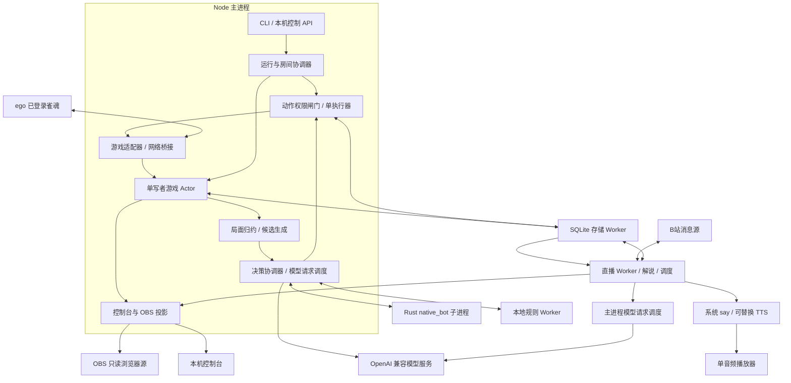
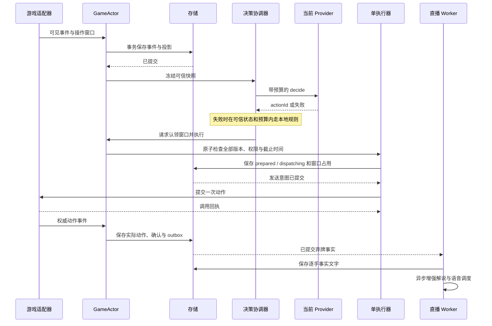
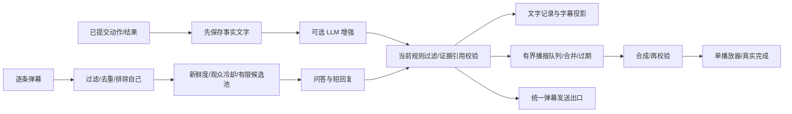
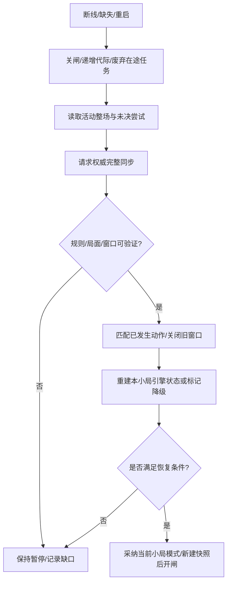

# 程序架构设计

[文档导航](../README.md) · 设计

依据：[需求方案](../planning/PLAN.md)、[开源调研](../research/RESEARCH.md)、[程序模型](./DOMAIN_MODEL.md)。状态：完整目标方案；阶段 1 离线子集已落地，实际范围见[状态基础](../validation/state-foundation.md)。没有把历史原型或上游 README 当作当前可用功能。

详细契约见 [HTTP 与事件流](../interfaces/API.md)、[内部模块与进程接口](../interfaces/INTERNAL_INTERFACES.md) 和 [OpenAPI 定义](../interfaces/openapi.json)。本文保留架构职责与关键流程，接口字段以对应契约为准。

## 目录

- [1. 架构选择](#1-架构选择)
- [2. 模块职责与依赖](#2-模块职责与依赖)
- [3. 游戏事件与事务边界](#3-游戏事件与事务边界)
- [4. 决策和执行关键路径](#4-决策和执行关键路径)
- [5. 专用引擎与通用 LLM](#5-专用引擎与通用-llm)
- [6. 直播调度、弹幕与音频](#6-直播调度弹幕与音频)
- [7. 本机控制台与 OBS 接口](#7-本机控制台与-obs-接口)
- [8. 暂停、恢复和故障隔离](#8-暂停恢复和故障隔离)
- [9. 存储、日志与运维](#9-存储日志与运维)
- [10. 取舍与实施门槛](#10-取舍与实施门槛)

## 1. 架构选择

首版采用本机模块化程序，以 Node.js／TypeScript 为主控，Rust 子进程封装 Akagi `native_bot`。不引入消息中间件、远程数据库或 DSH 宿主。游戏状态与动作执行只有一个写入者；直播任务通过有界异步通道消费游戏事实。

| 决策 | 选择与原因 | 约束或代价 |
| --- | --- | --- |
| 部署 | 一个 CLI 启动主程序，管理线程与子进程 | 主进程故障会停止自动操作；重启必须完整对账 |
| 状态 | 纯 reducer＋脱敏事件日志＋检查点 | 需要维护事件 schema 和协议版本，不能从截图猜关键状态 |
| 动作 | 单执行器、窗口占用、先记录发送意图、权威事件确认 | 不承诺网络意义上的 exactly-once；不明结果暂停同步 |
| AI | 引擎和 LLM 使用统一候选契约，按小局锁定一种 | AI 失效只降级为本地规则，不在小局中偷偷换另一模式 |
| 存储 | 本机 SQLite＋音频文件 | 串行写入与保留清理；存储故障关闭动作权限 |
| 直播 | 独立 worker 处理互动、解说、TTS、调度 | worker 重启时按交付记录恢复，未决外部发送不盲重试 |
| 网页 | 本机控制台与独立只读 OBS 页面，共用展示投影 | OBS 页面不持有控制令牌；不暴露凭证或完整原始状态 |
| UI 实现 | 轻量 TypeScript 控制台，HTTP＋SSE | 组件框架在建工程时固定；可选 VTB 角色前端通过独立输出适配接入 |

### 进程与数据流



图中的 worker 是同一工程启动的本机线程，不是独立部署服务。存储 worker 串行处理写事务，直播 worker 隔离互动故障，本地规则 worker 避免牌理计算阻塞网络消费。Rust 引擎单独管理生命周期；它的标准输出仅用于进程协议，日志写标准错误。

模块中涉及同步计算的部分必须有规模上限。主进程不等待语音、直播回复或网页消费者；所有订阅队列都有容量和溢出策略。游戏事件队列溢出时不能丢一条继续打，必须关闭执行并重新同步。

## 2. 模块职责与依赖

```text
src/
  cli.ts                     启动、停止和离线重放入口
  app/                       依赖装配、生命周期、故障监督
  domain/
    game/                    牌、座位、局面、规则约束、纯 reducer
    decision/                快照、候选、证据、尝试与确认类型
    live/                    内容、消息、播报与渠道状态类型
  application/
    run/                     会话、房间、整场上限与人工接管
    game/                    事件消费、信任状态、同步与重放
    decision/                模式锁定、预算、降级、动作仲裁
    live/                    解说、观众筛选、内容调度
    output/                  展示投影、交付与音频协调
  ports/                     游戏、引擎、模型、消息、TTS、存储接口
  adapters/
    majsoul/                 ego 桥接、协议映射、UI 开关、规则读回
    akagi/                   子进程 RPC、mjai 转换、候选映射
    llm/                     Chat Completions 与响应校验
    local-rule/              向听/进张/已验证安全性计算
    bilibili/                消息归一化、发送、鉴权引用与重连
    speech/                  macOS say、音频转换与播放器
    storage/                 SQLite、迁移、脱敏导出与文件回收
    web/                     HTTP、SSE、访问边界与页面投影
  workers/                   live、storage、local-rule 入口
  schemas/                   配置、进程消息、LLM 与 API 运行时校验
  observability/             结构化日志、指标与错误分类
web/
  console/                   控制台页面
  obs/                       只读字幕与局面卡
native/
  engine-runner/             包装 native_bot 的 Rust 可执行程序
config/                      无秘密的默认配置与示例
tests/                       单元、契约、回放、故障注入测试
docs/                        全部需求、设计、调研、验证与使用资料
data/                        SQLite、脱敏样本、音频和运行日志；忽略提交
```

以上目录是新工程目标，不在本次文档任务中创建占位代码。依赖方向为 `adapters → ports / application → domain`；application 通过注入的 port 调用外部能力，不直接依赖 adapter。domain 不导入 Node 网络、页面工具或供应商 SDK。

| 模块 | 拥有的状态 | 允许产生的副作用 |
| --- | --- | --- |
| RunCoordinator | session、停止意图、controlEpoch、房间流程 | 通过游戏适配器建房／续局／开关，不直接绕过权限闸门 |
| GameActor | 当前 GameState、事件游标、连接代际 | 记录事实、发布已提交事件、请求同步 |
| DecisionCoordinator | 当前 decision、provider 任务、超时与窗口占用 | 请求 AI／本地规则，把已选候选交给执行器 |
| ActionExecutor | 当前提交槽位、未决尝试 | 唯一的程序游戏动作发送 |
| ModelBroker | 服务并发、优先级、超时、熔断状态 | 调用模型服务，取消客户端请求 |
| LiveDirector | 互动短历史、解说任务、待发布内容与优先级 | 生成内容、提交播报计划、请求统一弹幕出口 |
| SpeechController | 唯一播报队列、合成任务、当前音频、队列与播放代际 | 请求 TTS、启停一个播放器；记录真实完成 |
| BiliGateway | 连接、源游标、身份、自发消息与节流 | 接收消息、唯一弹幕发送出口 |
| ProjectionService | 可重建的展示快照、投影版本 | 向控制台／OBS 发 SSE，不调用游戏执行器 |
| StorageService | 事务、游标、保留关系、交付记录 | 唯一 SQLite 写入者，管理音频元数据 |

## 3. 游戏事件与事务边界

### 网络入口

游戏适配器负责订阅已获授权的现有连接，解码当前版本的协议，将允许的公开事实与自己的可见信息转成规范事件。页面菜单、创建房间、电脑补位、自动和牌开关由适配器封装 UI 操作。

历史调研只证明连接接口曾可使用，未留下当前实现或样本。因此不在此设计中虚构页面函数、协议操作码、现成后台 HTTP 接口。阶段 0／1 必须验证持续采集、同步、发送和控件定位；若 ego 桥接不能稳定提供这些能力，先形成替代适配结论，不能让核心模型依赖一次页面脚本的偶然行为。

规范事件包括 `RoomVerified`、`MatchStarted`、`HandStarted`、`TileDrawn`、`TileDiscarded`、`MeldDeclared`、`RiichiDeclared`、`RiichiAccepted`、`DoraRevealed`、`OperationOffered`、`OperationClosed`、`HandEnded`、`MatchEnded`、`Disconnected`、`SyncApplied`。名称为本工程定义；内部接口规定所需语义，源端映射由重新采集的脱敏样本固定。

```ts
interface GameEventEnvelope<T> {
  schemaVersion: number;
  eventId: string;
  sessionId: string;
  matchId?: string;
  handId?: string;
  sequence: number;          // 本地持久化顺序
  connectionEpoch: number;
  source: 'majsoul-network' | 'majsoul-sync' | 'local-control';
  sourceCursor?: string;     // 仅在源端确实提供时使用
  sourceDedupKey?: string;
  occurredAt?: string;
  receivedAt: string;
  payload: T;
}
```

源序号有缺口、顺序矛盾或归约不变量失败时，先关闸再请求完整同步。源端没有可靠游标时，只能用已验证的语义键和状态约束去重；不能用“牌张相同”或 WebSocket 请求号当成通用事件 ID。跨重连重复事件在新代际归约前进行对账，不能直接追加一遍。

### 单写者与提交顺序

GameActor 以邮箱串行处理领域事件和控制命令。处理一条游戏事件时：

1. 校验来源代际、顺序与重复键，计算下一局面和副作用计划。
2. 在存储 worker 的事务中写事件、必要的投影／检查点、动作确认和待消费通知。
3. 事务成功后替换内存局面，发布对应已提交事件。
4. 如有新的操作窗口，再发起冻结和决策；如状态不可信，只发起同步。

事实尚未落库时不推进新的动作。磁盘写入慢到接近截止时间时，可以丢弃该次程序决策机会并关闭闸门，不能跳过持久化。收到暂停／断线等关闸信号时，优先在内存关闭权限并递增 `controlEpoch`，不等排队写入完成才停止动作。

存储维护独立的 `action_slots`：每个操作窗口一行，记录占用者和当前尝试；`action_attempts` 保存多次明确未接受后的审计记录。只有在事务中判定旧尝试已明确未发送／未接受且当前窗口仍可用，才能换占用者。重复协调请求返回原尝试，不产生第二次外部发送。

直播事件使用同库的持久化 outbox 与消费游标，至少一次交付。直播 worker 的处理以源事件 ID／内容 ID 去重；事实模板写入与消费游标推进在同一事务中，重启后补齐遗漏的弃牌文字。已播语音和已发弹幕不因重放再发一遍。过期的历史互动只归档，不重新自动回应。

### 游戏接口契约

以下为语义接口草图；实际消息在进程／线程边界使用可序列化数据，`AbortSignal` 留在调用端。

```ts
interface GamePort {
  connect(profile: BridgeProfile, processInstanceId: string,
    signal: AbortSignal): Promise<BridgeCapabilities>;
  observe(signal: AbortSignal): AsyncIterable<GameObservation>;
  inspectRoom(signal: AbortSignal): Promise<VerifiedRoom>;
  createOrReuseRoom(target: RoomTarget, permit: RoomPermit,
    signal: AbortSignal): Promise<VerifiedRoom>;
  setAutoWin(enabled: boolean, permit: TogglePermit,
    signal: AbortSignal): Promise<VerifiedToggle>;
  startMatch(command: FencedRoomCommand, signal: AbortSignal): Promise<CallReceipt>;
  synchronize(request: SyncRequest, signal: AbortSignal): Promise<AuthoritativeSync>;
  execute(command: FencedActionCommand, signal: AbortSignal): Promise<CallReceipt>;
  close(reason: string): Promise<void>;
}

interface DecisionProvider {
  decide(input: DecisionSnapshot, signal: AbortSignal): Promise<DecisionResult>;
}

interface SpeechPort {
  synthesize(input: ApprovedSpeechText, signal: AbortSignal): Promise<AudioArtifact>;
}

interface PlaybackPort {
  play(input: PlaybackRequest,
    signal: AbortSignal): Promise<PlaybackOutcome>;
  stop(target: { speechId: string; playbackEpoch: number }): Promise<void>;
}
```

DTO 的字段与错误语义见内部接口；GameObservation 是尚未分配持久化序号的归一化入口数据。`FencedActionCommand` 包含 attemptId、actionId、一次性许可，其 fence 绑定 session／match／hand／decision／window、局面和控制代际，不接受观众或模型传入的原始协议参数。

## 4. 决策和执行关键路径



执行器不只比对动作 ID，还必须同时满足：

- session 运行／整场后停止状态允许当前动作；没有人工接管；闸门开启。
- hand、stateVersion、connectionEpoch、controlEpoch、windowId 与快照一致。
- 游戏入口不存在尚未解码／归约的潜在关键消息；有积压时先处理事实，再决定旧快照是否仍有效。
- 截止时间有效且仍有发送预算；候选仍可完整映射当前手牌实例。
- 窗口没有被其他决策占用，没有在途／未决发送，没有客户端自动和牌竞争。
- 发送意图成功持久化。

检查与窗口认领在同一个 actor 执行片段中完成。持久化等待期间，暂停或新事件仍可使权限失效，因此实际桥接发送前再次核验代际；适配器在最后一个可控发送点检查同一 fence。已经交给远端的命令无法靠取消撤回，只能等待事实和同步对账。

游戏入口接收消息时立即标记待处理状态，不能等 reducer 完成才让执行器知道有新事实在途。发送与远端事件之间仍有不可消除的网络竞争，最终合法性由游戏服务校验，失败按拒绝／未决流程处理。

立直等多步骤动作由适配器的受控步骤状态机推进，始终关联同一个尝试。每一步仅在前一步预期事件已确认、当前局面符合预期、暂停代际未变化时取得新的步骤许可；出现意外转换就同步，不重试整个动作。

模型返回超时后调用端废弃该结果，递增决策任务代际；即使请求无法真正取消也不能再进入执行器。旧结果、自动和牌先完成、他家操作导致状态变化、新小局开始、暂停或降级已执行，都使原任务失效。

### 本地规则降级

可信状态下，主 provider 超时、崩溃、非法输出或动作映射失败时，调用独立的本地规则 worker。规则只在同一个合法集合中选择：

1. 放弃可选吃、碰、杠和立直；有合法 `pass` 时可以选它。
2. 必须弃牌时，优先考虑对已识别立直对手有证据的安全候选，再按已验证的向听、进张等指标稳定排序。
3. 没有已证明的全体安全牌时，不声称“绝对安全”；多个目标间的排序策略必须记录和测试。
4. 客户端自动和牌继续由客户端处理；本地规则不额外发和牌命令。

本地规则也有预算、版本校验和可用性检查。若它不能在当前合法候选中形成有效动作，或关键状态已不可信，则暂停程序动作，等待权威事件／同步。降级不能成为绕过局面校验的通道。

## 5. 专用引擎与通用 LLM

### Rust 引擎 Runner

对调研固定版本的 Akagi `native_bot` 编写薄包装；源码与模型许可、文件摘要和版本单独登记。原有桌面自动操作模块不启用，避免出现第二个游戏控制者。不能直接调用 `native_bot` 的假想 HTTP 服务。

采用带协议版本的 JSON Lines 作为本地 stdin/stdout RPC：

```json
{"v":1,"id":"r-17","runnerEpoch":"runner-example","method":"decide","scope":{"handId":"h-3","decisionId":"d-19"},"params":{"stateVersion":42,"expectedCursor":38,"snapshotHash":"sha256:..."}}
```

`init / reset / replay / advance / decide / shutdown` 是本工程 runner 的方法，适配器将它们转换为真实库调用。成功响应带相同请求 ID、runnerEpoch、scope 和相应 result；decide 结果包括关联游标、引擎版本与可映射建议。错误响应给出稳定错误码。单行大小、等待时间和在途请求数均设上限，不能把模型日志混在 stdout。

每小局初始化引擎，按已提交游戏事实有序输入 mjai 事件。`decide` 只接受游标与当前快照一致的状态。引擎建议不提前写回游戏状态；只有游戏事实发生后才推进引擎。

引擎退出、状态差异或序列缺失时标记该实例不可用，废弃在途结果，在可信局面下走本地规则。重启后从本小局起点重放完整所需事件，并验证游标／快照关联后才重新接入。若同步不足以恢复引擎所需历史，本小局继续本地降级，下一小局重新初始化；不能凭当前手牌假造缺失历史。

候选映射必须覆盖红五、具体鸣牌组合、杠类型及立直弃牌。Akagi 原始前三候选不保证参数完整，不能直接成为领域候选。优先验证首选完整映射；只保留确有来源的指标，不用其他动作的分数填空。

### LLM 请求隔离

出牌与解说分别构建请求和上下文：

| 用途 | 输入 | 可解析输出 | 失败行为 |
| --- | --- | --- | --- |
| 出牌 | 当前小局上下文、冻结局面、合法候选、比分与顺位目标 | `actionId`、可选短理由 | 本地规则；迟到结果丢弃 |
| 逐手解说 | 当时快照、实际动作、证据与角色配置 | 允许的解释模板／证据引用、角色措辞、限制 | 保留事实模板 |
| 观众问答 | 过滤后问题、有限互动历史、明确引用的事实 | 回答、字幕／口播、独立短回复、引用 | 丢弃过期问题或使用合适的事实模板 |

统一 ModelBroker 管理同一服务的并发。设计默认总并发 2，保留 1 个出牌名额，直播最多 1 个；阶段 0 需验证服务容量再确定配置。若服务只允许 1 个请求，游戏运行时默认关闭直播 LLM 请求，解说用模板并保留文字互动事件，不能让聊天持续占住唯一决策名额。

取消本机 HTTP 请求不代表远端已释放算力，因此不把“抢占直播请求”视为严格的容量保证。遇到服务端 429／超时，出牌按预算降级，直播做冷却；两类请求各自统计延迟和错误。

每小局销毁出牌上下文；新的请求只注入本小局事件和最新公共场况，不把上一小局完整对话续接进去。互动历史独立限长限时，旧局事实只能通过 ID 明确查询。模型没有本机工具或游戏接口访问权。

事实层使用确定模板和结构化插槽渲染，验证引用属于当时快照且匹配对应模板。问答中涉及的对局事实也走相同渲染；自由角色措辞不得增加新的牌张、数值、风险或结果断言。不能仅靠 JSON 合法和证据 ID 存在就宣称自然语言事实已校验。

现有 `MAJI_AI_BASE_URL / MODEL / API_KEY / RESPONSE_FORMAT / TIMEOUT_MS` 保持兼容。`MAJI_AI_TIMEOUT_MS=15000` 是配置上限，不能覆盖动作预算。可以配置两个模型用途指向同一个服务，也可以分别指向不同服务。

## 6. 直播调度、弹幕与音频

### 内容管线



LiveDirector 从 outbox 恢复所有己方弃牌的事实文字，每条按动作事件 ID 幂等保存。普通讲解不需要逐手都调用 LLM；强制摸切等可以使用模板。已生成内容在四个渠道独立记录交付，某一渠道故障不拖住其他渠道。

聊天优先影响语音与直播 LLM 调度，但不会删除逐手档案。输入池、生成任务、待合成、待播放分别有容量；达到上限时先淘汰过期互动、合并未播普通讲解。结果／故障通知限频，不能形成无限高优先级队列。

每个任务检查 `handId / contentId / expiresAt / moderationRevision`，待播／合成任务还检查 `queueEpoch`，已获准播放的任务检查 `playbackEpoch`。新小局到来后，上一小局任务要么转成显式回顾，要么取消；纯事实档案仍写回原小局。已被合并或静音取消的合成结果完成后直接回收。

### B站适配

优先评估调研中的独立 `lib/bili.js`，只复用验证过的收发能力，不带入 DSH 宿主。保留替换消息源的 port，包括模拟输入、直连来源和其他已验证转发器。

- 收到逐条事件即归一化、过滤、去重、排除本账号消息；不以最近消息快照代替事件流。
- 重连使用有上限的退避；支持源端重放则对账，不支持则记录缺口，不能杜撰丢失消息。
- 所有发送通过一个出口执行预演、禁词、平台长度、全局节流、内容去重和自回复标记。
- 发送前先落记录，返回平台认可的成功回执才标记 published；超时记 uncertain，不能无限重发。
- 发送身份以实际适配返回的账号标识验证，不能只比较显示名称；无稳定身份时加上本机发送回声缓存并记录限制。

实际文字回发首次联调在房号与本机登录配置完成后进行；离线模拟和预演可以先完成。生产预演开关是所有发送的统一检查点，不允许手工发送路由绕过。

### 中文语音与 OBS 音轨

当前使用 Fish 云合成 MP3，经平台适配器验证后播放。默认本机播放器为 Mac `afplay` 或 Linux `ffplay`，使用固定可执行程序与参数数组启动，`shell: false`；用户名和模型文本不能拼进 shell 命令。声音通过本机 Fish 配置选择；只有合成结果不等于音轨已验证。

播放模式二选一：

1. **首版默认：本机播放器。** OBS 采集经验证的独立语音输出路径，字幕页只展示。调试时也可使用同一音频路径本地试听。阶段 0／3 验证当前系统与 OBS 是否能分别调节游戏和语音；做不到时必须调整输出设备或采用下述方案后再验收。
2. **可选角色：OBS 浏览器音频。** `--avatar` 装配 `AvatarOutput.speech`，仅一个持有播放租约的页面播放，带 `speechId / playbackEpoch` 回报开始、结束与错误。其他预览页静音，不与本机播放器同时播音。播放回执只拥有音频确认权限，不是控制台权限。

播放器退出／播放结束事件是完成依据；只有合成文件、音频时长或 SSE 发送成功都不能证明已经播完。静音立即撤销播放代际、停止当前播放并取消待播任务；解除静音后只处理仍有效的内容，不补播整个历史。

### 可选 Live2D 输出

当前复用 Soullink Emotion SDK 的参数规划、情绪混合与 Live2D/Pixi 适配；固定版本与历史候选比较见 [LIVE2D.md](../research/LIVE2D.md)。最终合并并过滤的口播通过 SDK 自定义 Fish provider 合成，浏览器解码的实际时长与模型参数范围交给动作规划器；原 SpeechController 唯一调度，不增加第二份聊天回答或长期播报队列。

角色模式使用一个持播放租约的浏览器端，以同一 AudioContext 驱动声音、动作和口型；本机播放器停用，其他预览页静音。回执绑定 speechId、playbackEpoch、rendererId 与 leaseId；准备、开始、结束、取消和失败分别处理。租约具有失联到期停播机制，确认旧播放端停止或到期后才允许换端。渲染重建使旧身份失效，恢复时不补播历史；模型配置在启动时加载。

动作规划故障可保留本地情绪、口型与音频；整个角色播放端不可用时保留字幕，不改变游戏控制、不同时启动另一端补播。现有 `/obs` 与 SSE 保持只读，`/api/avatar/*` 单独处理唯一租约与播放回执。契约见 [内部接口](../interfaces/INTERNAL_INTERFACES.md) 和 [HTTP 定义](../interfaces/API.md#73-live2d-角色播放)，实际验收见[角色输出记录](../validation/live2d.md)。

## 7. 本机控制台与 OBS 接口

服务只监听 loopback。控制台首次打开使用短期启动令牌建立本机会话；校验请求 Origin 和会话令牌。CLI 调用同一应用命令，不另建可绕过状态机的执行路径。凭证只通过本机配置引用，网页不显示或编辑真实 Cookie／密钥。

接口包括运行命令、配置与查询、语音控制、只读 OBS 投影及可选角色播放通道。完整路由与时序集中在 [API.md](../interfaces/API.md)，路径／字段以 [openapi.json](../interfaces/openapi.json) 为准，本文不再复制另一份路由表。Live2D 专用接口使用直接 JSON，保持与控制台业务命令的身份和完成语义分离。

业务修改请求带 commandId 和 issuedAt，配置更新另带 expectedRevision，需要绑定当前运行的命令带 sessionId。恢复、结束、下局模式还校验 expectedControlEpoch。冲突返回明确错误和当前版本。异步命令返回 CommandView；接受后的失败也通过该记录查询，不能把 HTTP 200／202 等同于游戏已完成。

OBS 投影只包含播出需要的模式、场风／局数／本场／供托、四家分数、宝牌指示牌与实际宝牌、剩余牌数、最近动作、简短解说和当前问答。不把当前候选、隐藏手牌原始对象、登录信息和全部互动历史直接序列化给它。

SSE 使用 projection.epoch／revision 与事件游标；断线后优先从可用游标续传，游标过期则发送携带完整快照的 reset。慢客户端可以丢中间展示帧并接收最新快照，不能拖住 GameActor。界面明确显示暂停、同步中、降级模式和信息未知，不能显示过期局面为实时。

## 8. 暂停、恢复和故障隔离

### 立即暂停与人工接管

1. 同步关闭动作闸门，递增 `controlEpoch`，拒绝新窗口认领和房间自动开始。
2. 取消在途决策与未发送动作；已经发出的尝试保留 awaiting／uncertain，继续被动采集事实。
3. 尽力关闭并读回客户端自动和牌，显示开关验证结果。没有证实关闭时，提示“程序已停止提交，客户端仍可能自动行动”；不能承诺服务器暂停。
4. 对已有提交完成对账，保留所有真实动作；语音是否静音由独立按钮决定，普通新出牌解说在暂停时不伪装为自动操作。
5. 人工接管期间不擅自恢复控制。恢复必须由本机命令触发，重新验证自动和牌、房间与当前状态后才开闸。

### 连接恢复或进程重启



进程重启默认停在暂停状态，不能自动接管正在被用户操作的页面。恢复原 sessionId、起始时间、已完成场次和停止意图，仅更新 processInstanceId。已知仍在同一小局时沿用其 `activeMode`，不把恢复当成新小局；发现跨局时创建真实的新 `handId`。缺失历史无法重建时明确记录信息缺口；游戏状态已验证也不能假装引擎历史已恢复。

正常网络重连可在本机已启用自动恢复策略且无人工接管时，经过上述全部验证后恢复；首版默认要求本机恢复命令。无论哪种策略，都不能跳过未决动作对账。

| 故障 | 处理与继续条件 |
| --- | --- |
| 引擎进程退出／LLM 超时或无效 | 局面可信则本地规则；迟到结果丢弃，记录降级 |
| 本地规则失败／预算已耗尽 | 不再提交，等待权威状态；必要时暂停同步 |
| 游戏断线／协议未知／事件缺失 | 立即关闸；完整同步并验证后恢复 |
| 动作提交结果不明 | 锁住该窗口并同步；不重试原命令 |
| 客户端自动和牌先完成 | 废弃当前决策，记录真实来源，按权威事件推进 |
| 直播 worker／B站断线 | 游戏继续；有限重启／重连，过期互动不回放 |
| 解说 LLM 故障 | 保留逐手事实模板，语音可仅播模板 |
| TTS／播放器故障 | 文字继续，语音标记失败；不阻塞游戏 |
| OBS 关闭／SSE 慢消费者 | 游戏与档案继续；重连获取最新展示快照 |
| SQLite 写失败／磁盘不足 | 关游戏执行，报告明确错误；不能无记录发送动作 |
| 主进程退出 | 正常退出显式停止受管子进程；意外退出后处理遗留进程，重启默认暂停并对账 |

worker 重启采用次数与时间上限，避免无限重启占满 CPU 或磁盘。健康状态至少区分 ready、degraded、unavailable、recovering；“整个程序在线”不能掩盖某个输出已失败。

不能假定操作系统在父进程崩溃时自动杀死全部子进程。runner 监听父管道关闭后退出；播放器使用受管进程标识和所有权记录，启动时先确认并回收本程序遗留的播放器，再允许新播放。意外崩溃可能让已开始的一句声音继续，应作为故障验证项；不能因此把未收到完成事件的语音标成已播完。清理只针对已验证归属的进程，不能按名称停止用户的其他应用。

## 9. 存储、日志与运维

SQLite 在 storage worker 串行访问，迁移按 schema 版本执行；使用事务保证事件、动作确认、提交槽位和 outbox 的一致性。写入分级：执行记录和游戏事实优先，互动／指标批量写入；关键写入失败返回错误，不能被日志吞掉。

建议运行布局：

```text
data/
  app.sqlite                 结构化事实与状态
  audio/<sessionId>/         合成文件与派生格式
  logs/<date>/               脱敏结构化运行日志
  replays/<fixtureId>/       手工保留的脱敏样本与版本清单
```

运行数据默认保留 7 天；活动整场、正在播放的音频和未决尝试受引用保护。离线样本只有显式导出并检查脱敏后才作为长期测试资产，保留意图和版本写入 manifest；不能偷偷把全部运行原文复制到样本绕过保留策略。

日志至少关联 `sessionId / matchId / handId / decisionId / windowId / attemptId / contentId / speechId` 中适用字段，记录模块、事件、耗时、错误码、降级和取消原因。认证帧不落日志，错误对象中的 URL 查询、请求头和正文先脱敏；观众被禁词拦截的原文不进入普通错误栈。

关注的指标包括：事件消费延迟、主进程事件循环阻塞、状态同步次数、决策耗时与超时比例、降级次数、未决动作数、逐手文字覆盖率、互动等待时间、队列深度、被合并／取消／过期任务数、真实播完／发送成功比例。指标用于发现缺口，不以“请求成功数”冒充实际动作和播出成功数。

退出流程先关闭动作闸门和新房间动作，持久化停止状态，标记未决发送，再停止 worker、引擎与播放器；不主动解散房间。用户要求整场后停止时走 RunCoordinator 的正常收尾，而不是直接杀进程。

## 10. 取舍与实施门槛

首版不训练麻将模型，不为每一步同时调用两个决策 provider，也不让虚拟主播框架拥有动作权限。先完成事件、执行和恢复，再完善娱乐表达；牌理分析字段按实测能力渐进增加。

仍需实测的主要门槛是：当前 ego 桥接的持续采集与最终发送控制、当前雀魂协议与所有动作分支、Akagi Mac CPU 延迟及完整映射、B站消息身份与发送、系统语音格式与独立 OBS 音轨。它们都有明确的验证与失败出口，详见 [实施与验收](../planning/IMPLEMENTATION.md)。在这些门槛通过前，不能把本设计称为已完成的自动直播程序。
