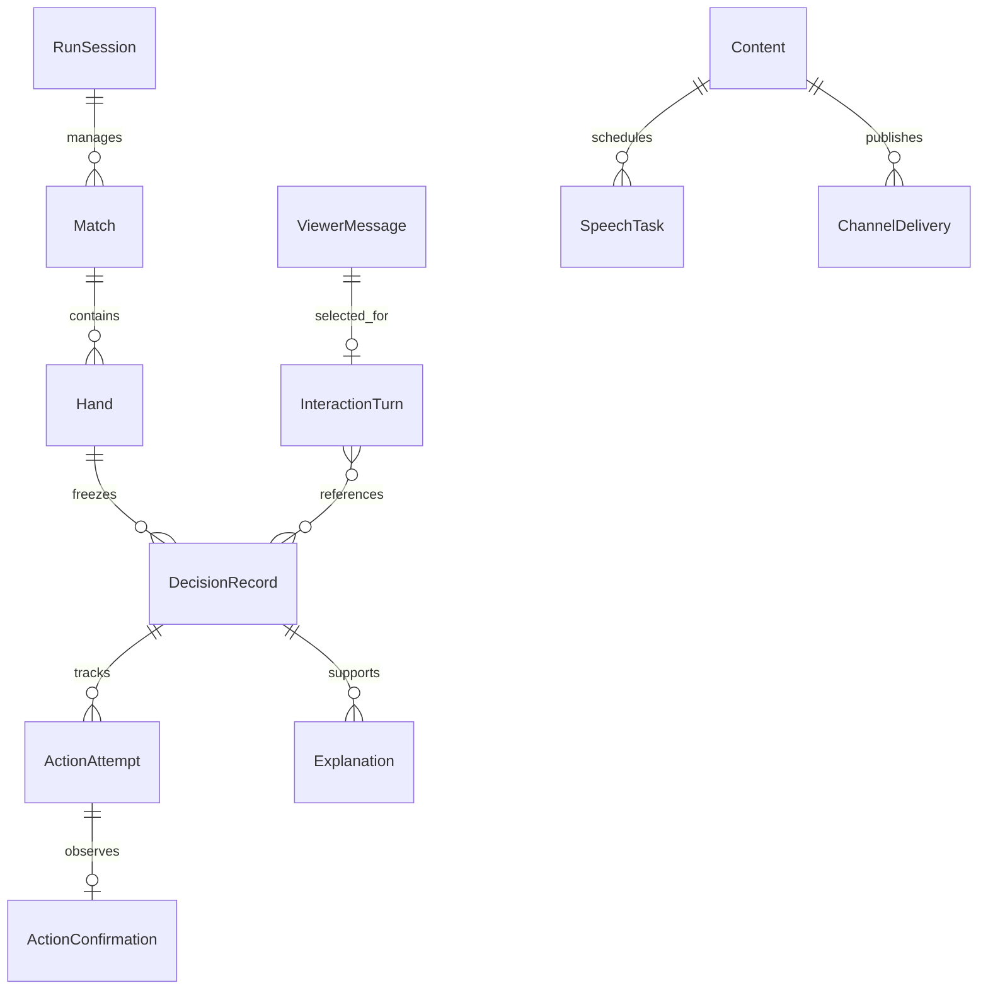
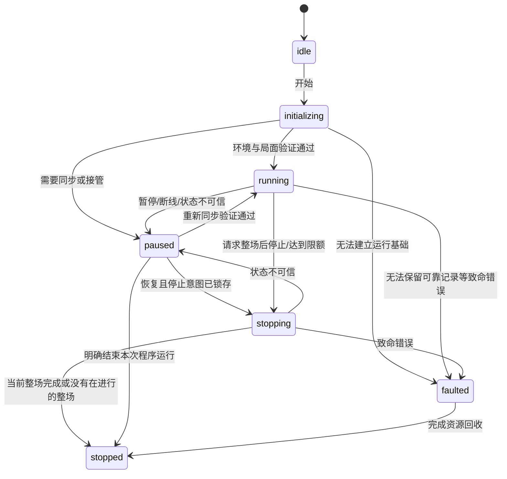
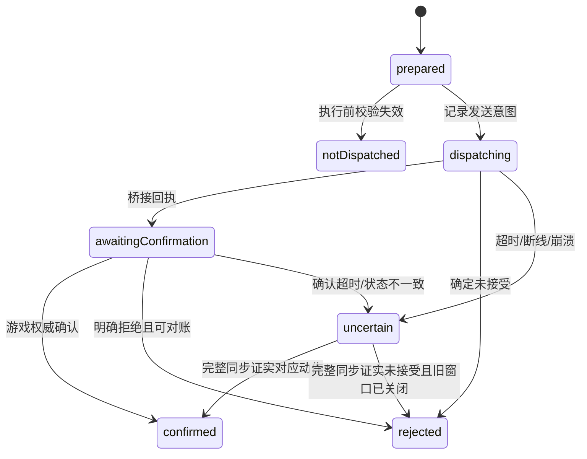

# 程序模型设计

[文档导航](../README.md) · 设计

依据：[需求方案](../planning/PLAN.md)、[开源调研](../research/RESEARCH.md)。状态：完整目标领域与接口设计；已实现的阶段 1 子集及差异见[状态基础](../validation/state-foundation.md)。本文的“模型”包括程序数据结构、业务状态机和 AI 输入输出契约。

## 目录

- [1. 领域边界与不变量](#1-领域边界与不变量)
- [2. 标识、时间与关联](#2-标识时间与关联)
- [3. 运行、房间、整场与小局](#3-运行房间整场与小局)
- [4. 局面与可见信息](#4-局面与可见信息)
- [5. 合法动作与操作窗口](#5-合法动作与操作窗口)
- [6. 冻结决策、模型输出与证据](#6-冻结决策模型输出与证据)
- [7. 提交尝试与权威确认](#7-提交尝试与权威确认)
- [8. 解说与历史追问](#8-解说与历史追问)
- [9. 观众消息、筛选和互动](#9-观众消息筛选和互动)
- [10. 播报任务与渠道交付](#10-播报任务与渠道交付)
- [11. 配置与存储模型](#11-配置与存储模型)
- [12. 对外命令与投影](#12-对外命令与投影)
- [13. 可选角色输出模型](#13-可选角色输出模型)

## 1. 领域边界与不变量

划分为六个领域：运行控制、游戏局面、决策执行、解说证据、观众互动、内容播出。原始雀魂字段只存在于游戏适配层；领域模型不依赖页面对象、协议数字操作码或某个模型供应商。

首版必须始终满足：

1. 只有当前可信局面可以生成动作；未知关键字段、事件缺失和恢复中都关闭执行。
2. 一次决策绑定一个小局、一个局面版本和一个操作窗口；候选 ID 只在这次决策内有效。
3. 所有程序动作经过同一个执行器；客户端自动和牌拥有单独且明确的权限，不与程序争抢和牌操作。
4. 模型返回值只能引用合法候选；冻结快照、模型建议与实际确认的动作分别保存。
5. 新小局清空出牌上下文，包括连庄；公共比分等事实重新注入。
6. 每次己方确认弃牌都有文字记录；语音可以合并或过期，文字历史保留逐手关联。
7. 直播内容不能控制游戏；输出前使用当前禁词规则重新检查。
8. 外部调用不能因本机超时就被视为失败；动作提交后必须对账，不能盲目重发。

## 2. 标识、时间与关联

| 标识 | 生命周期与含义 |
| --- | --- |
| `sessionId` | 一次用户开始到结束的连续运行；进程崩溃后恢复保留此 ID、起始时间和限额进度 |
| `processInstanceId` | 每次主进程启动生成，用于区分同一 session 的不同进程实例 |
| `matchId` | 一整场；优先关联游戏权威标识，本地 ID 不随重连变化 |
| `handId` | 一个小局实例；不能只用“东一局”命名，连庄仍产生新 ID |
| `decisionId` | 一次冻结快照与候选选择；状态失效后重新创建 |
| `windowId` | 适配器识别的一个有效操作机会；重建局面时须与原窗口对账 |
| `attemptId` | 一次程序提交尝试；重连和重启后仍能查询其记录 |
| `connectionEpoch` | 每次连接／同步代际；旧代际的候选和桥接句柄不能复用 |
| `controlEpoch` | 暂停、恢复、接管、关闭执行时递增，用于废弃在途任务 |
| `eventId` / `sequence` | 本地持久化事件唯一标识／会话内递增序号；不能替代源端序号 |
| `contentId` / `speechId` | 一条生成内容／一次具体播报计划；同一内容可对应多个渠道 |

持久化时间统一使用 UTC ISO 8601；控制台按 Asia/Shanghai 展示。进程内倒计时使用单调时钟，避免系统时间校正造成超时倒退。持久化截止时间和来源，恢复后重新同步计算预算，不复用旧的单调时钟值。

```ts
type Id<K extends string> = string & { readonly __kind: K };
type SessionId = Id<'session'>;
type MatchId = Id<'match'>;
type HandId = Id<'hand'>;
type DecisionId = Id<'decision'>;
type ActionId = Id<'action'>;
type WindowId = Id<'window'>;
type AttemptId = Id<'attempt'>;
type TileInstanceId = Id<'tile-instance'>;
type MeldId = Id<'meld'>;
type ContentId = Id<'content'>;
type SpeechId = Id<'speech'>;
type MessageId = Id<'message'>;
type Timestamp = string; // 运行时校验 UTC ISO 8601
type Seat = 0 | 1 | 2 | 3; // 游戏绝对座位，不随自家座位旋转
type DecisionMode = 'engine' | 'llm';

interface Scope {
  sessionId: SessionId;
  matchId?: MatchId;
  handId?: HandId;
  decisionId?: DecisionId;
}
```

面向模型和界面的“自家／下家／对家／上家”由绝对座位转换。每份引擎适配说明必须固定座位转换规则并用样本验证。

## 3. 运行、房间、整场与小局



`ActionConfirmation` 表示程序提交的确认；客户端自动和牌、服务器代打和人工操作也形成 `ObservedAction`，但不伪造程序提交记录。`Content` 通过来源关联 `Explanation`、`InteractionTurn` 或系统事件。

```ts
interface RunSession {
  id: SessionId;
  processInstanceId: Id<'process'>;
  status: 'idle' | 'initializing' | 'running' | 'paused'
    | 'stopping' | 'stopped' | 'faulted';
  startedAt: Timestamp;
  lastResumedAt?: Timestamp;
  finishedAt?: Timestamp;
  controlEpoch: number;
  pendingMode: DecisionMode; // 初值 engine，每次 HandStarted 才采纳
  limits: { maxMatches: number; maxDurationMs: number };
  completedMatches: number;
  stopAfterMatch: boolean; // 限额到达或用户请求后锁存
  pauseReason?: string;
}

interface FriendRoom {
  roomId: string;
  status: 'disconnected' | 'lobby' | 'creating' | 'waiting'
    | 'starting' | 'playing' | 'settling' | 'unknown';
  rules: {
    players: 4;
    length: 'east';
    displayTimeSetting: '300+0';
    computerSeats: 3;
    verifiedOptions: Record<string, string | number | boolean>;
    protocolVersion: string;
  };
  autoWin: 'verified-on' | 'verified-off' | 'unknown';
}

interface Match {
  id: MatchId;
  gameMatchKey?: string;
  roomId: string;
  status: 'starting' | 'playing' | 'settling' | 'finished' | 'interrupted';
  startedAt: Timestamp;
  finishedAt?: Timestamp;
  handIds: HandId[];
  finalScores?: Record<Seat, number>;
  finalRanks?: Record<Seat, number>;
}

interface Hand {
  id: HandId;
  matchId: MatchId;
  ordinal: number; // 此整场实际进行的第几个小局，连庄也递增
  gameHandKey?: string;
  activeMode: DecisionMode; // 本小局不可修改
  startedAt: Timestamp;
  finishedAt?: Timestamp;
  status: 'playing' | 'settling' | 'finished' | 'interrupted';
}
```

运行状态与房间状态是两个维度：`paused + playing` 合法，表示游戏服务器仍在运行。`stopping` 表示禁止下一整场、继续完成当前整场。若此时状态不可信，先进入暂停，保留 `stopAfterMatch`，不能为了赶整场结束而绕过可信度校验。

默认限额为 3 场或从会话开始计算的 60 分钟，暂停时间也计入。任一阈值到达便锁存停止意图；当前整场结束后停下并保留房间，未开场则直接停止。整场计数只在权威整场结算确认后递增一次。限时不是强制中断计时器。

崩溃恢复沿用原 session 的 `startedAt / completedMatches / stopAfterMatch`，不能通过重启重置限额。只有明确结束原 session 后启动新的运行，才重新计时计数；存在未决整场时仍须先对账。



新整场的 `start` 命令也必须经过执行权限检查，先检查停止意图，再检查房间、规则和三个电脑席位。恢复运行不等于自动重开一场。

## 4. 局面与可见信息

```ts
type NumberRank = 1 | 2 | 3 | 4 | 5 | 6 | 7 | 8 | 9;
type TileCode = `${NumberRank}${'m' | 'p' | 's'}`
  | `${1 | 2 | 3 | 4 | 5 | 6 | 7}z` | '5mr' | '5pr' | '5sr';

interface TileInstance {
  instanceId: TileInstanceId;
  code: TileCode;
}

interface Meld {
  id: MeldId;
  actor: Seat;
  kind: 'chi' | 'pon' | 'open-kan' | 'closed-kan' | 'added-kan';
  tiles: TileCode[];
  fromSeat?: Seat;
  calledTileIndex?: number;
  upgradedFrom?: MeldId;
}

interface RiverEntry {
  tile: TileCode;
  tsumogiri: boolean | null;
  riichiDeclaration: boolean;
  calledBy?: Seat;
  eventId: string;
}

type Knowledge<T> = { known: true; value: T }
  | { known: false; reason: string };

interface PlayerView {
  seat: Seat;
  score: number;
  river: RiverEntry[];
  melds: Meld[];
  riichi: 'none' | 'declared' | 'accepted';
  concealedCount: Knowledge<number>;
}

interface GameState {
  sessionId: SessionId;
  matchId: MatchId;
  handId: HandId;
  connectionEpoch: number;
  stateVersion: number;
  trust: 'trusted' | 'syncing' | 'untrusted';
  trustIssues: string[];
  ownSeat: Seat;
  players: Record<Seat, PlayerView>;
  ownConcealed: TileInstance[]; // 包含已摸入且尚未打出的牌
  drawnTileRef: Knowledge<TileInstanceId | null>; // 指向 ownConcealed，不重复存牌
  dealer: Seat;
  roundWind: TileCode;
  seatWind: TileCode;
  handNumber: number;
  honba: number;
  riichiSticks: number;
  doraIndicators: TileCode[];
  doraTiles: TileCode[]; // 按已验证的本场规则推导，不与指示牌混用
  tilesRemaining: Knowledge<number>;
  currentActor: Knowledge<Seat>;
  latestAction?: ObservedAction;
  operationWindow?: OperationWindow;
  unknownFields: string[];
}
```

风牌字段运行时限制为风牌编码，不能只依赖宽泛的 `TileCode` 类型。红五保留独立编码；向听等需要基础牌种的算法显式转换，执行和显示不能丢失红牌身份。`TileInstanceId` 是本地、代际内稳定的选择引用，不假定服务器提供实体牌 ID；适配器将其映射为当前手牌位置或接口参数，重新同步后重建。

其他玩家的隐藏手牌、未公开牌山、未来摸牌不进入 `GameState`、模型请求或日志。原始网络即使带有额外字段，也必须通过可见信息白名单投影。可选字段使用 `Knowledge` 或缺省；关键字段不明时将 `trust` 降为 `untrusted`，不能以 `0` 或空数组冒充已知。

`stateVersion` 在每次影响可见局面或操作有效性的领域事件后递增；心跳、弹幕、播报进度不改变它。重复事件不能重复推进版本。同步会改变 `connectionEpoch` 并废弃原窗口；状态投影可被重建，已冻结记录不可被重写。

## 5. 合法动作与操作窗口

```ts
type ActionSpec =
  | { kind: 'discard'; tile: TileInstanceId; tsumogiri: boolean }
  | { kind: 'riichi'; discardTile: TileInstanceId; tsumogiri: boolean }
  | { kind: 'chi' | 'pon'; fromSeat: Seat; calledTile: TileCode;
      consumed: TileInstanceId[] }
  | { kind: 'open-kan'; fromSeat: Seat; calledTile: TileCode;
      consumed: TileInstanceId[] }
  | { kind: 'closed-kan'; tiles: TileInstanceId[] }
  | { kind: 'added-kan'; meldId: MeldId; tile: TileInstanceId }
  | { kind: 'pass' }
  | { kind: 'tsumo' }
  | { kind: 'ron'; fromSeat: Seat; winningTile: TileCode }
  | { kind: 'special'; handlerKey: string; variantKey: string };

interface LegalAction {
  id: ActionId;
  action: ActionSpec;
  authority: 'executor' | 'client-auto-win';
  label: string;
  evidenceEventIds: string[];
}

interface OperationWindow {
  id: WindowId;
  connectionEpoch: number;
  openedAt: Timestamp;
  deadline: Knowledge<{
    at: Timestamp;
    sourceEventId: string;
    uncertaintyMs: number;
  }>;
  candidates: LegalAction[];
  status: 'open' | 'claimed' | 'submitted' | 'closed' | 'uncertain';
}
```

合法候选由客户端操作提示、可信手牌和规则校验共同构造；引擎不能向集合中新增动作。运行时检查吃碰消耗牌数、杠类型、牌实例归属、鸣牌来源、立直绑定的具体弃牌及特殊动作的已注册参数约束。

`special` 只引用代码中已审查、已验证的适配处理器和变体；映射参数留在适配器内部。未知操作码不能包装成一个可执行的 `special`。若它影响当前选择完整性，暂停并记录协议缺口。

立直在领域内是“声明＋确定弃牌”的一个动作。如果客户端要求多次接口或页面步骤，适配器内部按步骤观察确认；中途结果不明即关闭执行并同步，不把整个动作重试一遍。

开启并确认客户端自动和牌后，`tsumo`／`ron` 可以记录在合法集合中，但不交给引擎／LLM选择，也不由执行器提交。和牌机会出现时，仲裁器将该窗口保留给客户端，等待权威事件；超时未发生则暂停核验开关与局面。不得在同一个窗口继续提交 `pass`、鸣牌等竞争动作。

操作截止时间必须来自验证过的客户端字段，并计入时钟误差；`300+0` 只记录房间设置，不能当作单步预算。关键截止时间不明时暂停同步，不能随意套用 `.env` 的模型超时。

## 6. 冻结决策、模型输出与证据

```ts
interface DecisionSnapshot {
  id: DecisionId;
  scope: Required<Scope>;
  windowId: WindowId;
  stateVersion: number;
  connectionEpoch: number;
  controlEpoch: number;
  createdAt: Timestamp;
  actionDeadline: Timestamp;
  activeMode: DecisionMode;
  state: Readonly<GameState>;
  legalActions: readonly LegalAction[]; // 仅 executor 权限；和牌窗口不创建决策
  knownFacts: { id: string; text: string; sourceEventIds: string[] }[];
  unknownFields: string[];
  contextEventIds: string[]; // 当前小局的有界上下文
  schemaVersion: number;
}

interface DecisionEvidence {
  id: string;
  kind: 'observed-fact' | 'rule-metric' | 'engine-preference' | 'estimate';
  source: string;
  sourceVersion: string;
  sourceEventIds: string[];
  actionId?: ActionId;
  name: string;
  value: string | number | number[];
  unit?: string;
  targetSeat?: Seat;
  limitations: string[];
}

interface DecisionResult {
  decisionId: DecisionId;
  stateVersion: number;
  provider: DecisionMode | 'local-rule';
  actionId: ActionId;
  evidence: DecisionEvidence[];
  fallbackReason?: 'timeout' | 'invalid-output' | 'provider-unavailable'
    | 'unmappable-action' | 'insufficient-budget';
  elapsedMs: number;
  providerVersion: string;
}

interface DecisionRecord {
  snapshot: DecisionSnapshot;
  status: 'pending' | 'selected' | 'invalidated' | 'executing'
    | 'confirmed' | 'uncertain' | 'failed';
  providerResults: DecisionResult[]; // 主结果和降级结果分别保留
  acceptedResult?: DecisionResult;
  invalidationReason?: string;
}
```

快照需要深复制、只读序列化并计算校验值；`Readonly` 只是编译期提示，不代表已实现深冻结。记录存储的快照是唯一解释基准，不能引用仍在变化的局面对象。`scope` 中的 `decisionId` 必须等于 `id`。

通用 LLM 的可解析输出保持最小：`{ "actionId": "...", "reason": "可选短理由" }`。响应本身不构成牌理证据；`reason` 只作未验证的模型陈述，不能直接当成事实播出。服务不支持结构化输出时用严格 JSON 解析和同等的运行时校验，不能从一段自由文本里猜动作。

专用引擎输出映射后返回相同的 `DecisionResult`。记录模型与源码版本、可用的偏好分数和独立分析指标；没有完整动作参数或无法唯一映射合法候选时判为无效，不按名称近似匹配。选择时考虑顺位、比分、场况；实际指标能力取决于已验证的上游接口，不能编造模型未提供的风险估计。

softmax、logits 或策略分布属于 `engine-preference`；只有具有定义、单位和来源的估计才可用概率语言。安全牌描述必须注明针对的玩家和依据；不能把针对一家立直的安全性扩展到所有对手。

模型请求预算取配置超时与当前动作剩余可用时间的较小值，并预留本地规则、提交、确认和时钟误差预算。若预算不足，可信状态下直接尝试本地规则；连安全提交时间都不足时关闭该窗口的程序提交并等待游戏事件／同步，不能发送已过期动作。

## 7. 提交尝试与权威确认

```ts
interface ActionAttempt {
  id: AttemptId;
  scope: Required<Scope>;
  windowId: WindowId;
  actionId: ActionId;
  stateVersion: number;
  connectionEpoch: number;
  controlEpoch: number;
  status: 'prepared' | 'dispatching' | 'awaiting-confirmation'
    | 'confirmed' | 'rejected' | 'uncertain' | 'not-dispatched';
  preparedAt: Timestamp;
  dispatchedAt?: Timestamp;
  transportReceipt?: string; // 脱敏回执引用，不是游戏成功凭据
  errorCode?: string;
}

interface ObservedAction {
  eventId: string;
  handId: HandId;
  actor: Seat;
  kind: ActionSpec['kind'];
  tiles: TileCode[];
  origin: 'program' | 'client-auto-win' | 'manual' | 'server'
    | 'unknown';
  observedAt: Timestamp;
}

interface ActionConfirmation {
  attemptId: AttemptId;
  decisionId: DecisionId;
  observedAction: ObservedAction;
  matchedBy: 'authoritative-event' | 'authoritative-sync';
  confirmedAt: Timestamp;
  resultingStateVersion: number;
}
```

唯一约束覆盖 `(sessionId, handId, connectionEpoch, windowId)` 的程序提交槽位。暂停、决策重算和 provider 切换不能释放已提交或结果不明的槽位；已明确未发送的尝试才允许在重新校验后继续。跨 session 恢复时还须查询同一整场的未决尝试并向游戏对账，不能依靠新 sessionId 绕过旧提交。

`prepared` 先持久化再调用桥接；`dispatching` 持久化后才允许发生外部发送。若进程在两者之间或发送中崩溃，恢复时将可能发送的记录视为 `uncertain`。即使只记录到 `prepared`，也先同步当前游戏，不从旧快照直接补发。

接口回执只能表明调用被接收；游戏事件或完整同步确认对应座位、动作、具体牌、操作窗口／事件顺序后，才确认成功。如果同步只能证明窗口已关闭，不能证明具体动作，则保留未决结果并明确记录；不可补造当时的决策解释。

多步骤立直的后续步骤仍属于同一个 `attemptId`。前一步的权威事件可以推进局面版本，后续步骤必须按已验证的预期状态转换重新取得当前版本的执行许可；不能拿原始快照版本盲发，也不能因为版本变化就把整套操作重做一遍。



持久化状态使用 `not-dispatched`、`awaiting-confirmation`，图中的驼峰名称仅为 Mermaid 语法标识。拒绝不意味着自动重发；只有确定未接受、当前窗口仍有效且经过新校验，才可由协调器显式创建新尝试。首版对模糊拒绝一律同步。

## 8. 解说与历史追问

```ts
interface Explanation {
  id: string;
  decisionId?: DecisionId; // 服务器代打等没有程序决策时允许缺省
  observedActionEventId: string;
  handId: HandId;
  source: 'llm' | 'fact-template';
  factText: string;
  personaText?: string;
  evidenceIds: string[];
  limitations: string[];
  createdAt: Timestamp;
}

interface Content {
  id: ContentId;
  source: { kind: 'explanation' | 'interaction' | 'system'; id: string };
  scope: Scope;
  texts: { archive: string; subtitle?: string; speech?: string; reply?: string };
  evidenceIds: string[];
  personaRevision: number;
  moderationRevision: number;
  createdAt: Timestamp;
  expiresAt?: Timestamp;
}
```

每个己方 `discard` 权威事件先生成并保存事实模板，再异步请求可选的牌理解释；模板与增强结果属于同一条弃牌记录的修订，不能因此重复口播／回发。弃牌来自本地降级、服务器或人工时，说明实际来源；无决策证据便只陈述事实。

立直动作后实际发生的弃牌同样计入每手文字。只看到立直声明而未确认具体弃牌时，不发布“已经打出”的解说。已确认后即使立刻进入新小局，旧小局文字记录仍需补齐，语音改为明确回顾或过期。

`factText` 引用可追踪事实，角色化措辞不能改比分、动作、模型来源。历史提问先定位 `matchId / handId / decisionId`，只取那一手的冻结快照、实际结果和当时已知证据。定位不唯一时澄清或限定为“最近一次已确认弃牌”，不能用当前手牌倒推。

可信事实文本由已验证的事实／指标模板渲染；LLM 只能选择允许的证据引用和解释模板，再添加角色措辞。牌张、数值和实际动作使用确定的事实插槽，超出模板支持范围的策略断言不进入事实层。引用一个真实证据 ID 本身不足以证明一段自由文本正确；不符合契约便退回事实模板。

## 9. 观众消息、筛选和互动

```ts
interface ViewerMessage {
  id: MessageId;
  source: string;
  roomId: string;
  sourceMessageId?: string;
  dedupKey: string;
  viewerKey: string; // 本机会话内稳定的最少必要身份，不暴露登录凭证
  displayName: string;
  text: string;
  receivedAt: Timestamp;
  sourceAt?: Timestamp;
  senderIsSelf: boolean;
  moderationRevision: number;
  status: 'accepted' | 'blocked' | 'duplicate' | 'self' | 'expired';
}

interface InteractionTurn {
  id: string;
  messageId: MessageId;
  referencedDecisionIds: DecisionId[];
  status: 'selected' | 'generating' | 'ready' | 'published'
    | 'partially-published' | 'dropped' | 'failed';
  selectedAt: Timestamp;
  expiresAt: Timestamp;
  contentId?: ContentId;
}
```

源端有稳定消息 ID 时优先用其去重；没有时用房间、观众、源时间／短时间桶和正文摘要组成有 TTL 的键，并记录可能误合并的限制。同一观众重复发同一句话不能永久被过滤。断线后的历史消息先去重并检查新鲜度；不假定消息源能够补齐断线缺口。

持久化的 `text / displayName` 为过滤后的内容；被阻断消息只保留去重摘要、原因和最少必要关联，不保存被屏蔽原文。

输入过滤用户名和正文后，选择器按新鲜度、相关性、观众冷却和重复主题筛选。默认全局选择间隔 5 秒、同观众 30 秒，都是可调试播初值。有限候选池满时淘汰过时或低优先级消息，不能无限排队。

观众文本始终作为数据传入，无本机命令权限。消息自称管理员也不能改变模式、风格配置、禁词或工具调用权限。回复的 `reply` 独立生成，初始限制 20 个 Unicode 字符；仍须满足适配器已验证的平台长度约束。

## 10. 播报任务与渠道交付

```ts
interface SpeechTask {
  id: SpeechId;
  contentIds: ContentId[]; // 合并回顾可以引用多条内容
  scope: Scope;
  kind: 'critical' | 'viewer-chat' | 'move-commentary';
  priority: number;
  mergeKey?: string;
  createdAt: Timestamp;
  expiresAt: Timestamp;
  moderationRevision: number;
  queueEpoch: number; // 待播队列代际；清空队列使旧合成结果失效
  state: 'queued' | 'synthesizing' | 'ready' | 'playing'
    | 'completed' | 'merged' | 'cancelled' | 'expired' | 'failed';
  audioArtifactId?: string;
  playbackEpoch?: number;
}

interface ChannelDelivery {
  id: string;
  contentId: ContentId;
  channel: 'archive' | 'subtitle' | 'speech' | 'bili-reply';
  status: 'pending' | 'publishing' | 'published' | 'simulated' | 'blocked'
    | 'cancelled' | 'expired' | 'uncertain' | 'failed';
  moderationRevision: number;
  publishedAt?: Timestamp;
  externalReceipt?: string;
}
```

语音通常按“必要结果／故障 > 观众聊天 > 普通讲解”调度，同类按新鲜度与排队时间选择。必要通知也要限频，避免故障反复播报占住队列。普通聊天等当前句播放结束后开始；立即静音可以中断。

合并只作用于尚未开始播放的普通讲解，并保留所有原内容 ID；原始逐手文字不删除。跨小局只能生成标为回顾的新文本，否则取消旧语音。语音合成完成不等于播放完成；完成必须来自实际播放器或持有租约的 OBS 页面确认。

每个渠道独立记录结果：字幕成功、语音失败、文字回弹幕超时可以同时存在。B站发送超时记 `uncertain`，在不能查证时不自动重发，防止刷屏；档案文字与 OBS 投影可用内容 ID 幂等更新。

预演的弹幕交付记 simulated，不计入真实 published。清空待播队列只递增 queueEpoch，当前句仍使用原播放许可完成；立即静音同时撤销队列和 playbackEpoch。具体命令与完成条件见 [HTTP 接口](../interfaces/API.md)。

禁词配置热更新后，待发布文本和待播音频全部重新核验；若文本被替换，废弃旧音频并重新合成。被阻断的原文不写入普通日志，仅保留类别、摘要和必要关联。对已经发出的弹幕或已经播放的声音，记录实际结果，不能声称可以撤回。

## 11. 配置与存储模型

配置分为三个层级：版本化默认值、被忽略的本机非秘密配置、环境变量／本机凭证。界面只返回密钥是否配置，不能返回密钥值。版本化示例不得含真实 B站身份、Cookie 或模型密钥。

| 配置组 | 内容 | 生效时间 |
| --- | --- | --- |
| `game` | 房间目标、规则、动作预算预留、协议版本 | 未开局时；影响连接时先暂停 |
| `run` | 3 场／60 分钟、默认模式；pendingMode 由运行控制持有 | 限额立即检查，默认模式用于新 session，下局模式命令在小局边界采纳 |
| `models` | 出牌／解说服务映射、超时、并发、引擎路径 | 在途请求取消或使用原配置完成并受版本校验 |
| `persona` / `moderation` | 角色、口头禅、强度、禁词替换 | 后续生成和所有待发布内容 |
| `interaction` | 冷却、候选池上限、新鲜度、短回复长度、预演 | 后续调度；发送前再检查 |
| `speech` | 中文声音、TTS 提供方、播放模式、静音 | 后续合成；切换播放端时撤销旧租约 |
| `output` | 本机端口、OBS 输出样式 | 视觉样式即时；监听配置重启生效 |
| `retention` | 默认保留 7 天 | 后续清理，不删除活动记录 |

首版采用 SQLite 保存结构化事实、尝试和交付状态；音频作为独立文件。状态与外部动作的关键记录必须持久化成功才继续执行，存储失败关闭游戏执行；观众事件压力不能挤占动作记录的写入机会。

| 表／投影 | 主要键与查询用途 |
| --- | --- |
| `sessions`, `rooms`, `matches`, `hands` | 生命周期、房间规则、整场计数与小局模式 |
| `commands` | commandId、请求指纹、时间、目标 session、状态与结果；幂等跨进程恢复 |
| `events` | 唯一 `eventId`、`(sessionId, sequence)`，按整场／小局重放脱敏领域事件 |
| `state_checkpoints` | 按整场、小局、事件序号和投影版本保存快照与校验值 |
| `decisions`, `decision_evidence` | 决策快照、结果、证据、版本与原因 |
| `action_slots`, `action_attempts`, `action_steps`, `action_confirmations` | 操作窗口提交槽位、发送意图、多步骤许可／回执、确认和未决恢复 |
| `observed_actions`, `explanations` | 每个己方弃牌事件恰有一个文字档案条目 |
| `viewer_messages`, `interactions` | 去重、有限互动历史、历史决策引用 |
| `contents`, `speech_tasks`, `channel_deliveries` | 内容修订、合并／取消、每渠道实际发布状态 |
| `config_revisions`, `artifacts` | 不含秘密的配置修订、音频文件路径与引用关系 |
| `outbox`, `consumer_offsets` | 已提交事实向直播侧的可靠通知与幂等消费游标 |

候选、局面和快照可保存为带 `schemaVersion` 的 JSON；需要检索的 ID、状态、时间、版本单独建列与索引。检查点只能加速重放，不是恢复外部游戏的权威来源。回放时仍使用当时 schema／reducer 版本或显式迁移，不能静默套用新的解释。

按整场维护保留关系：活动整场、未决尝试、正在引用的解释和播放中的音频不清理。已结束且超过默认 7 天的整场连同关联子记录清理；独立观众记录按过期时间清理，相关音频同步回收。清理不能留下指向已删快照的历史追问引用。

脱敏导出用于离线重放；没有认证帧、Cookie、密钥和隐藏牌。运行日志只记脱敏摘要和关联 ID，原始网络包默认不落盘。详细事务边界、模块接口与恢复流程见 [架构设计](./ARCHITECTURE.md)。

## 12. 对外命令与投影

CommandView 记录用户控制意图，ActionAttempt 记录实际游戏提交，两者不能混为一类。命令按 accepted／running／waiting-sync／uncertain／succeeded／failed／cancelled 推进；只有 succeeded／failed／cancelled 是终态。完整字段与完成条件见 [API.md](../interfaces/API.md) 和 [openapi.json](../interfaces/openapi.json)。

控制台和 OBS 使用分别定义的白名单 DTO。投影的 epoch／revision／cursor 与游戏 stateVersion、持久化事件 sequence 分别计数；界面变化、命令结果和语音进度都可以推进投影。OBS DTO 不含自己的完整手牌、候选、控制配置或身份信息。

## 13. 可选角色输出模型

Live2D 是直播表现层扩展，不进入 GameState、DecisionSnapshot 或合法动作集合。调研与资源要求见 [LIVE2D.md](../research/LIVE2D.md)，扩展类型和方法在 [INTERNAL_INTERFACES.md](../interfaces/INTERNAL_INTERFACES.md) 中集中定义，当前未纳入 HTTP DTO 或存储迁移。

| 模型 | 职责与关联 |
| --- | --- |
| AvatarProfile | 固定前端版本、模型资源、默认表情、语义到实际表情／动作的映射；与文案 persona 分开维护 |
| AvatarCue | 有时效的表情／动作计划，关联内容范围、模型修订与渲染代际；绑定语音时引用已有 speechId／playbackEpoch |
| AvatarReady／角色状态 | 当前渲染实例、模型修订与实际能力；模型切换或页面重建使旧指令失效 |
| 播放租约与回执 | 唯一播放端身份、有效期、语音与音频关联、真实开始／结束／取消／失败；映射回已有 SpeechTask 和 ChannelDelivery |

角色指令接受或表情应用成功不能使 speech 交付成为 published。语音仍以真实正常结束为完成依据；丢失回执记 uncertain。clear 保留当前句及其绑定表现，mute 停止当前声音和口型。没有相应模型资源时回退默认状态，不编造可执行的表情／动作 ID。
