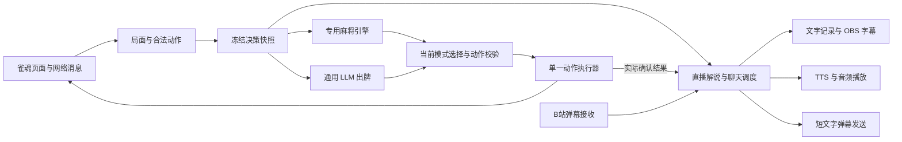

# AI 雀魂直播项目方案

[文档导航](../README.md) · 规划与验收

更新日期：2026-11-13（Asia/Shanghai）。状态：当前需求基线。已实现持续自动运行、故障监控、重建房间、错误语音和 Debian 13 运行适配；实现验证与长期实场验收分别记录。此前普通弃牌、重连同步和发送前暂停的实场证据见[当前实场范围](../validation/phase1-live.md)。

调研依据见 [RESEARCH.md](../research/RESEARCH.md)。本文统一替代旧自动化方案并维护首版需求；实际实现状态由验收记录说明。程序模型见 [DOMAIN_MODEL.md](../design/DOMAIN_MODEL.md)，架构见 [ARCHITECTURE.md](../design/ARCHITECTURE.md)，实施与验收见 [IMPLEMENTATION.md](./IMPLEMENTATION.md)，文档入口见 [README.md](../README.md)。阶段 1 的实现不改变本文的完整首版需求范围。

## 目录

- [产品目标](#产品目标)
- [已确认需求](#已确认需求)
- [首版复用路线](#首版复用路线)
- [整体结构](#整体结构)
- [对局信息与解释契约](#对局信息与解释契约)
- [弹幕、角色与播报节奏](#弹幕角色与播报节奏)
- [上下文隔离与恢复](#上下文隔离与恢复)
- [配置与日志](#配置与日志)
- [实施与产品验收](#实施与产品验收)

## 产品目标

在 Mac 或 Debian 13 上常驻运行一个独立的 AI 雀魂直播程序：能够自动完成友人场对局，处理故障后创建新房并继续自动出牌；将真实局面、实际选择和对局结果提供给直播解说模块，配合 B站弹幕聊天、中文语音和 OBS 画面。专用麻将引擎为当前连续模式，通用 LLM 决策模式保留为完整产品目标。

主播角色基调为“嘴硬但会认错的麻将搭子”，偏娱乐吐槽，主要吐槽自己的操作和局势。角色台词可以夸张，牌理和对局事实保持准确。名称、口头禅、风格和吐槽强度可编辑。

首版以稳定运行、观众能跟上对局、聊天回应自然为验收目标。牌力优化和完整虚拟角色形象在基础直播跑通后继续探索，不以短期几场胜负证明模型强弱。

## 已确认需求

| 范围 | 约定 |
| --- | --- |
| 运行环境 | Mac arm64 或 Debian 13，Node.js＋TypeScript 主程序、Rust 引擎与 OBS 输出 |
| 游戏入口 | Mac ego 或 Linux Chromium 中已登录的雀魂；友人场 → 创建房间 |
| 对局 | 四人友人场，新建默认半庄、5＋20 秒；先招募观众三分钟，再给空位补电脑 |
| 连续运行 | 无场数和时长上限；正常结算后继续招募，故障恢复后重建房间；人工停止有效 |
| 自动操作 | 弃牌、立直、吃、碰、明杠／暗杠／加杠、客户端提供的特殊可选动作；开启自动和牌 |
| 游戏通信 | 网络消息获取状态；沿用已获授权的现有连接接口操作，必要的菜单和开关使用页面操作；以游戏事件确认结果 |
| 决策模式 | 专用日麻引擎／通用 LLM 都保留；每小局开始时选择，默认专用引擎，小局内不切换 |
| 动作约束 | 只能选择当前合法候选，执行前再次校验；每次动作只有一个执行者 |
| 游戏目标 | 最终顺位优先，重视避免第四名；使用比分、场次、剩余牌数等信息 |
| 上下文 | 每小局独立，连庄也重新建上下文；比分等公共场况重新注入 |
| 逐手讲解 | 自己每次弃牌都有简短文字讲解；语音不阻塞出牌，积压时合并尚未播出的旧讲解 |
| 观众互动 | 筛选弹幕读出并回答，同时发简短文字；聊天优先且比每 15 秒一条更密集 |
| 语音 | Fish 中文语音；Mac 本机播放，Linux FFmpeg 播放；错误播报不依赖 LLM，尊重静音 |
| 禁词和风格 | 本地可编辑，输入、生成结果、字幕、语音及发回的弹幕经过统一处理 |
| 故障处理 | 监测心跳、对局进展和画面；异常先撤销旧执行器，再验证并重建房间、重新同步出牌；登录和协议问题须用户处理 |
| 干净画面 | 实场默认开启，采集故障自动重试；人工关闭后保持关闭，字幕和音轨各自输出 |
| 日志 | 默认保留 7 天，按整场／小局／决策组织，不保存密钥和登录凭证 |

“立即暂停程序”不代表服务器暂停牌局。用户接管浏览器时停止自动操作；恢复必须重新取得并验证状态。

## 首版复用路线

| 部分 | 选择 | 需要完成的接入工作 |
| --- | --- | --- |
| 游戏桥接 | 依据历史调研重新实现协议解码、同步和接口调用 | 重新校验当前客户端版本、所有动作分支、整场结算与同房续局 |
| 专用麻将 AI | 优先封装 Akagi v3 `native_bot`，通过独立进程接入 | 雀魂事件转 mjai、引擎状态重放、动作映射、版本和模型文件固定；实测 CPU 延迟 |
| 通用 LLM 出牌 | 现有 OpenAI 兼容 Chat Completions 服务 | 仅传本小局信息与合法候选，校验候选 ID、超时和迟到结果 |
| 牌理和解释 | 借鉴 Akagi 分析、Majsoul Agent 的决策快照与解释契约 | 所有理由绑定当时证据；支持按历史决策回答“刚才为什么” |
| B站消息 | 优先评估 `-dsh-bili-live` 中独立的 `lib/bili.js`；保留替换消息源的接口 | 移除宿主依赖，验证当前收发、身份、断线恢复和消息去重；不使用其最近消息快照作唯一事件源 |
| 中文 TTS | Fish 合成与平台音频适配器 | 声音选择、音频校验、取消／合并、播放完成确认和系统故障通知 |
| OBS 输出 | 本机浏览器源页面和单独语音输出 | 字幕、状态卡、音轨、重连、只读输出页面 |
| 可选 Live2D 角色 | Soullink Emotion SDK＋本项目唯一播放端适配 | 当前口播与 Fish 音频驱动参数动作、情绪和口型；透明 OBS 角色页、租约与实际播放回执，模型资源需单独配置，见 [Live2D 专题](../research/LIVE2D.md) |

这条路线复用组件和接口。当前调研没有找到在 Mac 上同时满足所有要求的现成直播插件。使用某个上游项目前记录源码和模型许可及版本，不把项目 README 的功能列表当作已验收能力。

## 整体结构



图中的两个决策提供方按当前模式选用，不要求每次都同时调用。语音合成、观众问答和 OBS 页面都不能阻塞游戏事件消费及动作执行。

### 游戏服务

负责建房、电脑补位、开局、网络采集、解码、状态重建、候选构造、动作提交、确认和连续运行。UI 定位与协议版本变化归入游戏适配层。

历史接口探索仅作为参考，新实现需要重新验证操作；接口提交成功后仍必须看到对应游戏事件。没有确认时先同步状态，不盲目重复操作。菜单、自动和牌等控件按实测页面识别；此前版本的“和”实测在左侧工具栏。

### 决策提供方

统一输入为 `DecisionSnapshot`，统一输出为候选 ID 与可选的有来源指标。专用引擎先验证四人日麻；通用 LLM 使用本机配置的服务。新小局应用待切换模式，界面显示当前模式和下局模式。

引擎输出、通用 LLM 输出都要映射回同一个合法候选集合。红五、具体吃牌组合、杠类型、立直及其弃牌必须完整；上游缺少参数的动作不能直接执行。未知或不一致的关键状态进入暂停。

### 直播服务

订阅游戏事实和已确认动作，接收观众弹幕，决定下一段说什么。它维护角色配置和短期互动历史，可引用具体历史决策；不直接调用游戏执行器。

讲解 LLM 与出牌 LLM 使用独立请求和上下文。可以共用一个模型服务配置，但需分别限制并发和时间，观众聊天不能占住游戏决策所需的请求机会。

### 本机控制台与 OBS 页面

实现 CLI 启动入口和本机网页控制台，提供：开始、立即暂停、恢复、整场结束后停止、下小局模式、直播房号／连接状态、静音／清理播报、角色风格、禁词、语音和互动频率。

OBS 使用独立只读页面，显示当前模式、场风／局数／本场／供托、四家分数、宝牌指示牌与实际宝牌、剩余牌数、最近动作、简短讲解、当前观众问答。控制按钮和凭证配置不进入 OBS 输出页。

首版采用声音、人设、字幕和状态卡形成角色体验。Live2D 通过 Soullink SDK 与本项目输出适配增加，属于基础直播之后的可选里程碑；VRM 另行评估。Fish 合成文件和实际播放器须验证音轨输出；角色模式由 OBS 角色页播放同一条音频，保持语音与游戏音量可分别调整。角色模式与本机播放模式共用一个播报调度器，同时只能有一个语音播放端。

## 对局信息与解释契约

### 每次决策的冻结记录

```text
DecisionSnapshot
  sessionId / matchId / handId / decisionId
  stateVersion / createdAt / actionDeadline
  activeMode / ownSeat
  hand / drawnTile / rivers / melds / riichiStates
  scores / dealer / roundWind / seatWind / handNumber / honba / riichiSticks
  doraIndicators / doraTiles / tilesRemaining
  legalActions / knownFacts / unknownFields

DecisionResult
  decisionId / stateVersion / provider / actionId
  evidence / fallbackReason / elapsedMs

ActionConfirmed
  decisionId / actualAction / confirmedAt / resultingStateVersion
```

动作截止时间来自经验证的游戏字段，不能仅从房间显示的 300＋0 推断。只有公开信息和自己的可见手牌进入模型；无法确认的信息显式标记未知。

在途模型结果绑定小局、决策和状态版本。状态变化、已降级、已自动和牌或小局结束后，迟到结果失效。引擎、LLM、本地降级都经同一执行器提交。

### 讲解输出

每次自己实际弃牌确认后生成一条简短讲解，通常一句话。依据包括冻结快照、实际动作、引擎建议和已计算的牌理指标。若需要提前准备文字，也只能在动作确认后作为“已经发生”的讲解发布。

输出分为：

- 事实与牌理：本次打了什么，有证据支持的取舍，哪些判断仍不确定。
- 角色表达：简短吐槽或口头禅，不能改写实际比分、牌型或操作来源。
- 渠道文本：字幕／文字记录、口播文本、面向观众的短弹幕。

强制摸切等没有策略选择的动作可用事实模板，不必每手额外调用 LLM。解释服务失败时仍记录实际动作和简短模板；不能编造理由。

Akagi 的策略分布表示模型偏好，不能说成和牌概率。只有存在对应估计、单位和来源时才讨论风险或概率。观众问“上一手为什么”时读取那一手的冻结记录；不把当前手牌倒灌为当时信息，也不让追问改变已执行动作。

## 弹幕、角色与播报节奏

### 弹幕进入流程

逐条接收消息，保存必要的来源、消息 ID／去重键、观众标识、接收时间与文本。先过滤和去重，再交给选择器。跳过本程序自己发出的消息，避免自动回应自身形成循环。

弹幕视作观众聊天内容；房间控制、游戏模式、系统配置仅由本机控制台改变。对局提问只读取必要的游戏事实，不让观众消息覆盖角色配置或触发任意工具。

聊天优先的试播初值：语音空闲时尽快处理选中的消息，全局选取间隔暂设 5 秒，同一观众暂设 30 秒，可在面板调整。这是依据“更密集”选择的初始参数，不保证每 5 秒播完一段问答；实际节奏受语音长度和模型延迟约束。过时或重复问题不无限排队。

### 播报优先级和积压处理

正常优先级为：必要的对局结果／故障说明、选中的观众问答、普通逐手讲解。普通讲解为聊天让出语音时间，每手文字记录仍完整。

待播内容持有 `speechId`、关联小局／决策、来源、优先级、创建时间、过期时间和合并键。游戏不断前进时，可以把几条尚未播出的旧讲解合并为一句回顾；新小局到来时，上一局未播内容只能作为明确标注的回顾，不能继续假装描述当前手牌。

同一时刻只播放一个声音。普通聊天优先安排在当前句结束后，故障提示可以打断旧解说，按来源去重并节流。立即静音／停止可以取消播放。模型请求和合成任务的迟到结果同样要检查是否仍需要播放。

### 禁词与回复风格

同一份可编辑配置处理观众文本与用户名、模型回复、字幕、TTS 和发回弹幕。命中后的行为支持丢弃或替换，默认不读出被屏蔽内容。风格热更新影响后续内容；已排队文本在发布前再次经过当前规则。

为发回直播间的文字单独生成短版本，初始目标不超过 20 个字符，独立校验长度与禁词。语音长句不能简单照搬成多条弹幕刷屏。所有真实发送共用一个出口管理节流、去重、预演状态和错误。

## 上下文隔离与恢复

| 上下文 | 生命周期 | 保存内容 |
| --- | --- | --- |
| 出牌上下文 | 一小局，连庄也重建 | 当前局内事件和决策；新局重新注入当前比分、场况 |
| 决策解释 | 一次不可变决策记录 | 当时局面、候选、选择、实际操作和证据，供回看追问 |
| 角色配置 | 跨运行配置 | 名称、风格、口头禅、禁词和音色，不混入过去手牌 |
| 互动历史 | 有长度与时效上限的直播会话 | 最近问答及引用的决策 ID；引用旧局时明确标注 |

游戏断线、事件缺失、关键字段不明或未知操作时先暂停。可恢复异常在旧执行器退出后处理旧房并重建新房；完整同步／重放并验证新状态后才恢复出牌。登录、协议和人工控制条件需要用户处理。解释、弹幕、TTS 或 OBS 故障只影响相应输出，不阻止可信状态下的 AI 继续打牌。

模型超时或非法输出且局面可信时，沿用已确认的本地降级规则：跳过吃碰杠和立直；弃牌优先考虑针对已识别立直对手的安全牌，否则按向听和进张排序；自动和牌继续处理。安全性必须注明针对哪一家。

## 配置与日志

模型地址、模型名、密钥继续使用本机配置；本次调研不读取或改写现有 `.env`。直播房号、B站登录、TTS 配置在实施联调时填写，不通过聊天发送秘密凭证。

日志按运行、整场、小局、决策和互动事件关联，至少能回答：

- 当时是什么局面，当前模式是谁，合法候选有哪些。
- 为什么选择该动作，实际执行结果是什么，是否发生降级。
- 观众问了什么，生成了什么，最终哪些文字／语音真的发布。
- 哪些内容被过滤、合并、取消或过期，耗时和错误分别发生在哪里。

默认保留 7 天，排除密钥、Cookie、认证网络消息等。使用最少必要的观众标识进行去重；回放数据不包含登录信息。记录清理不删除正在使用的日志。

## 实施与产品验收

完整阶段编号、依赖、场景和交付证据统一维护在 [IMPLEMENTATION.md](./IMPLEMENTATION.md)。先通过状态、动作与恢复门槛，再接双模式、可信解说、语音、弹幕和控制页面；OBS 先本地预览／录制，再验证实际直播。Live2D 按 [L0—L3](../research/LIVE2D.md#10-最小实施与验收) 单独验收，不替代基础功能。

产品完成至少要求：两种模式各完成真实整场、确认连续对局、每次己方弃牌有可追溯文字、选中弹幕能够回答并口播和短文字回发，且游戏不被语音或聊天阻塞。暂停恢复、未决动作、跨局任务、长期运行、故障重建房间、错误语音与 Debian 音视频输出须验证；未实场覆盖的罕见动作明确记录证据类型。

最终交付包括可启动的工程、控制台、OBS 页面、Debian 部署脚本、配置示例、脱敏回放样本、验证记录和故障接管说明。当前文档区分已实现能力与完整产品目标；真实整场、长期无人值守和直播音轨效果以相应实场验收为准。
