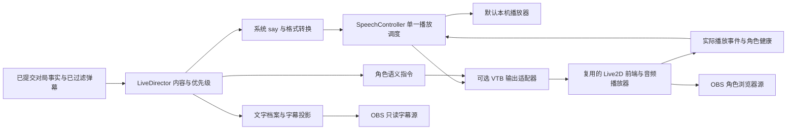

# Live2D 直播功能调研与接入设计

[文档导航](../README.md) · 调研

调研与设计日期：2026-11-05（Asia/Shanghai）。依据：[需求](../planning/PLAN.md)、[开源调研](./RESEARCH.md)、[架构](../design/ARCHITECTURE.md)。本轮读取了官方资料与固定版本源码，没有安装运行 VTB 项目、导入角色、发声或进行 OBS 联调。

## 目录

- [1. 采用方向与范围](#1-采用方向与范围)
- [2. 本轮核查的版本](#2-本轮核查的版本)
- [3. 功能对照](#3-功能对照)
- [4. Open-LLM-VTuber：适合优先验证，需修正播放语义](#4-open-llm-vtuber适合优先验证需修正播放语义)
- [5. AIRI：组件备选与依赖边界](#5-airi组件备选与依赖边界)
- [6. 角色资源与表现设计](#6-角色资源与表现设计)
- [7. 接入架构与单一播放端](#7-接入架构与单一播放端)
- [8. OBS 与本机验证](#8-obs-与本机验证)
- [9. 许可与分发边界](#9-许可与分发边界)
- [10. 最小实施与验收](#10-最小实施与验收)

## 1. 采用方向与范围

按“可以使用现有 VTB 开源项目”的要求，优先验证 **Open-LLM-VTuber 的现有角色前端＋本项目输出适配层**，复用模型加载、口型、表情与动作代码。**AIRI 的 Live2D／口型组件为备选**。这是结合现有链路和改造范围作出的工程选择，实际采用版本要通过下文的最小联调。

麻将程序保留事实来源、角色文案、禁词、观众筛选、语音优先级和交付记录；VTB 前端消费已经批准的字幕、音频与角色指令。首版系统 `say` 合成能力继续使用。只为展示角色时，不额外启用上游的第二套 LLM、弹幕回复、麦克风输入或工具调用。

基础目标是角色显示、眨眼／待机、说话口型、有限表情动作和透明 OBS 输出。摄像头面捕、手势捕捉、VRM、模型制作和 MotionSync 不列入这一轮接入验收。Live2D 是基础直播后的可选里程碑，失败不会影响游戏操作和逐手文字档案。

## 2. 本轮核查的版本

| 项目／组件 | 固定版本 | 证据与用途 |
| --- | --- | --- |
| Open-LLM-VTuber 后端 | `992309c0aa19845960228f880013d4685fde93b5` | [源码树](https://github.com/Open-LLM-VTuber/Open-LLM-VTuber/tree/992309c0aa19845960228f880013d4685fde93b5)，核查路由、消息方向、播放等待与模型配置 |
| 随该后端引用的前端构建 | `06a659b114fff788cf0daaa86e484576db4975bf` | [构建提交](https://github.com/Open-LLM-VTuber/Open-LLM-VTuber-Web/commit/06a659b114fff788cf0daaa86e484576db4975bf)，提交信息指明构建源版本 |
| 配套前端源码 | `3d57a9a0125a0ca13e5d096f7092e4e494ed389e` | [源码树](https://github.com/Open-LLM-VTuber/Open-LLM-VTuber-Web/tree/3d57a9a0125a0ca13e5d096f7092e4e494ed389e)，作为本专题的适配依据 |
| AIRI | `11b8989f6dd7f840cf6b15ce59e367656fb11ac6` | [源码树](https://github.com/moeru-ai/airi/tree/11b8989f6dd7f840cf6b15ce59e367656fb11ac6)，核查渲染、口型、音频与工作区依赖 |

不能把后端固定版本与任意最新前端拼接后声称已兼容。AIRI 的版本晚于综合调研中的 `e20d734`；两处是不同时间的核查快照，不把综合调研中的其他结论自动升级为新版本实测。

## 3. 功能对照

| 能力 | Open-LLM-VTuber 配套前端 | AIRI 核查版本 | 本项目要补的部分 |
| --- | --- | --- | --- |
| Live2D 加载 | 官方 Cubism Web SDK 路线 | `stage-ui-live2d` 与 Pixi 相关依赖 | 固定运行时、资源清单，验证目标角色兼容性 |
| 口型 | WAV 音量驱动 | wLipSync 驱动与口型平滑工具 | 使用同一条实际播放音频；验证中文、静音和暂停 |
| 表情／动作 | 表情名或索引，播放链会尝试 `Talk` 动作组 | 表情／动作 runtime API，角色控制策略 | 语义到实际资源映射、有效期、优先级与复位 |
| 外部输入 | 后端文本输入与前端音频接收是不同方向 | SDK 有文本／上下文输入；组件有音频播放能力 | 接收已批准音频的专用适配，不让上游再次生成回答 |
| 播放回执 | 有会话级完成通知，缺少逐条关联与严格结果区分 | 有浏览器播放器代码；部分外部观察协议仍是提案 | 对齐 `speechId`、代际、取消、失败与未决结果 |
| OBS | 有浏览器前端；桌面 pet 模式依赖 Electron | 可复用角色场景组件 | 透明专用视图、音频唯一所有者、重载与隐藏恢复 |
| 集成成本 | 现成完整前端，需维护少量适配修改 | 模块边界清晰，但依赖 monorepo 工作区 | 记录补丁和依赖范围，升级重新跑契约场景 |

上述判断来自下文具体源码，不表示两个项目已经提供本项目定义的 `AvatarPort` 或现成雀魂插件。

## 4. Open-LLM-VTuber：适合优先验证，需修正播放语义

官方 v1.2 公告说明前端迁移到官方 Live2D Web SDK，增加 Cubism 5 支持并移除 Cubism 2.1 支持；该版本公告同时说明尚未集成 MotionSync。这个版本边界不能推导为所有旧角色或所有新特性都可用。[官方发布说明](https://docs.llmvtuber.com/en/blog/v1.2.0-release/)

### 消息入口与方向

| 已核查入口／消息 | 实际用途 | 接入含义 |
| --- | --- | --- |
| `/client-ws`、`/proxy-ws` 的 `text-input` | 触发上游对话链 | 不直接用来朗读本项目已经审查过的解说 |
| `/tts-ws` | 根据文本合成并返回音频路径／合成完成 | 合成成功不代表角色已播放或 OBS 已收音 |
| 前端收到 `audio` | 音频、显示文本、表情进入前端播放任务 | 可复用接收与渲染代码，需要本项目桥接发送 |
| 前端收到 `set-model-and-conf` | 应用模型与角色配置 | 适配层从已登记模型档案生成配置 |
| `backend-synth-complete` → `frontend-playback-complete` | 后端等待前端队列完成 | 不能直接替代逐条语音的真实完成记录 |

入口定义见 [后端路由](https://github.com/Open-LLM-VTuber/Open-LLM-VTuber/blob/992309c0aa19845960228f880013d4685fde93b5/src/open_llm_vtuber/routes.py)、[后端消息分派](https://github.com/Open-LLM-VTuber/Open-LLM-VTuber/blob/992309c0aa19845960228f880013d4685fde93b5/src/open_llm_vtuber/websocket_handler.py)、[前端消息处理](https://github.com/Open-LLM-VTuber/Open-LLM-VTuber-Web/blob/3d57a9a0125a0ca13e5d096f7092e4e494ed389e/src/renderer/src/services/websocket-handler.tsx)。前端能收到 `audio` 不等于后端公开了任意外部音频推送接口；接入时要新增受控桥接，不能虚构上游路由。

### 复用时必须修改的细节

- 音频任务将输入按 `audio/wav` 使用；Mac 合成产物必须真正转换、验证格式，不能只改扩展名。
- `audio-play-start` 在等待可播放和调用 `audio.play()` 之前发送，不能作为真实开播时间。
- 正常结束、加载错误、播放拒绝等都会结束当前 Promise；缺少模型时也会直接结束任务。必须区分成功、失败、取消，且让角色失败可以降级为普通音频。
- `frontend-playback-complete` 没有逐条 `speechId`，不能对齐本程序的合并、过期和静音取消。
- 当前播放路径只使用 `expressions[0]`，并尝试随机 `Talk` 动作。动作存在性必须按角色档案检查。

这些差异直接来自 [音频任务实现](https://github.com/Open-LLM-VTuber/Open-LLM-VTuber-Web/blob/3d57a9a0125a0ca13e5d096f7092e4e494ed389e/src/renderer/src/hooks/utils/use-audio-task.ts)。后端确实在合成后等待会话级完成通知，见 [对话收尾](https://github.com/Open-LLM-VTuber/Open-LLM-VTuber/blob/992309c0aa19845960228f880013d4685fde93b5/src/open_llm_vtuber/conversations/conversation_utils.py)。本程序不伪造该通知来推进队列，而是由适配后的真实播放事件推进。

默认 MaoPro 资源清单有 `Idle` 与空名称动作组，没有 `Talk`；口型组指向 `ParamA`，也不能一律硬编码为 `ParamMouthOpenY`。[模型清单](https://github.com/Open-LLM-VTuber/Open-LLM-VTuber/blob/992309c0aa19845960228f880013d4685fde93b5/live2d-models/mao_pro/runtime/mao_pro.model3.json)

建议维护固定版本前端的有限补丁：增加输出桥接、逐条播放回执、取消与复位、无界面透明视图。可以先复用现有前端工程，不要求第一步就把所有代码拆成独立包。补丁不进入麻将领域模型；后端完整对话服务不是生产输出链的必要依赖。

## 5. AIRI：组件备选与依赖边界

`stage-ui-live2d` 已提供 `Live2DScene`、`createLive2D`、隔离的渲染上下文、表情执行和动作执行接口，可参考其角色策略与渲染状态分离方式。但该包标记 `private: true`，依赖多个 `workspace:^` 包与 catalog；不能写成已经发布、可单独安装的 npm 插件。[组件说明](https://github.com/moeru-ai/airi/blob/11b8989f6dd7f840cf6b15ce59e367656fb11ac6/packages/stage-ui-live2d/README.md)、[包与依赖](https://github.com/moeru-ai/airi/blob/11b8989f6dd7f840cf6b15ce59e367656fb11ac6/packages/stage-ui-live2d/package.json)

`model-driver-lipsync` 有 wLipSync 配置、元音权重和平滑策略，调用方拥有 AudioContext 与音源生命周期；现有 Live2D 驱动还可归约出单一张嘴值。不能因此宣称模型已经具备中文逐音素口型或完整 AEIOU 形变。[口型模块](https://github.com/moeru-ai/airi/blob/11b8989f6dd7f840cf6b15ce59e367656fb11ac6/packages/model-driver-lipsync/README.md)、[Live2D 驱动](https://github.com/moeru-ai/airi/blob/11b8989f6dd7f840cf6b15ce59e367656fb11ac6/packages/model-driver-lipsync/src/live2d/index.ts)

实际场景和浏览器播放器已有共享音频输出链路，可以复用同一音源驱动口型的做法。[角色场景](https://github.com/moeru-ai/airi/blob/11b8989f6dd7f840cf6b15ce59e367656fb11ac6/packages/stage-ui/src/components/scenes/Stage.vue)、[BrowserPlayback](https://github.com/moeru-ai/airi/blob/11b8989f6dd7f840cf6b15ce59e367656fb11ac6/packages/audio/src/browser/playback.ts)

外部 SDK 的文本／上下文输入不能直接等同于“播放已经批准的音频”。`observe-speech-output` ADR 状态仍为 proposed，不能把拟定的插件事件全部写成已实现接口。[SDK](https://github.com/moeru-ai/airi/blob/11b8989f6dd7f840cf6b15ce59e367656fb11ac6/packages/server-sdk/README.md)、[语音观察提案](https://github.com/moeru-ai/airi/blob/11b8989f6dd7f840cf6b15ce59e367656fb11ac6/docs/ai/adr/2026-10-31-observe-speech-output.md)

采用 AIRI 时先固定整个工作区版本并验证最小构建，再决定保留工作区构建还是提取所需依赖。目标角色的 Cubism 兼容性、资源释放和 OBS 音频仍需实测；MIT 源码许可也不覆盖另外分发的 Cubism Core 和角色素材。

## 6. 角色资源与表现设计

角色导入以运行时资源清单为单位：`.model3.json`、其引用的 `.moc3` 和纹理；物理、姿势、表情、动作按清单实际引用加载。Live2D 立绘图像本身不能替代绑定好的运行时模型。资源登记来源、摘要、版本与许可，本地资源 ID 解析到允许目录，不接收 LLM 或弹幕指定的任意路径／URL。

模型档案维护以下信息；正式扩展字段在 [内部接口 §5.4](../interfaces/INTERNAL_INTERFACES.md#54-live2d-角色输出可选扩展草案) 中定义：

| 类别 | 内容与约束 |
| --- | --- |
| 模型身份 | profileId、修订、上游 commit、modelAssetId；修改资源或映射产生新 modelRevision |
| 能力 | 可用表情 ID、动作 ID、口型方式；模型不支持的能力明确缺省 |
| 默认状态 | 实际中性表情、idle 动作、缩放与位置；不能假定编号 0 就是中性 |
| 语义映射 | neutral／thinking／joy／surprise／frustrated 映射到模型实际表情；idle／talk／greet／celebrate 映射到实际动作 |
| 生命周期 | 指令绑定有效期、模型修订、渲染代际；绑定语音的表现还绑定 speechId 与 playbackEpoch |

上游本身支持按名称／索引设置表情，并在复位时选择配置中的默认表情或第一个表情，因此需要显式维护本项目的中性映射。[表情实现](https://github.com/Open-LLM-VTuber/Open-LLM-VTuber-Web/blob/3d57a9a0125a0ca13e5d096f7092e4e494ed389e/src/renderer/src/hooks/canvas/use-live2d-expression.ts)

表现规则先采用确定映射：等待回答可短暂 thinking；问候可 greet；确认和牌／整场结果后才允许对应庆祝；讲话的口型来自实际音频。表情只是角色表达，不证明风险概率或模型置信度。未配置的语义回到中性／idle，不能随意套用一个可能相反的表情。

绑定语音的表情在实际开始时生效，结束、失败、取消或到期后复位；讲话动作、结果动作与待机之间有固定优先级。中止时关闭口型并停止讲话动作；后台掉帧、恢复或新小局不能补演过期庆祝。

### 口型层次

优先使用现有音量口型完成可靠闭环，再评估更细的元音映射。官方 WAV 示例根据 RMS 驱动口型，支持指定的线性 PCM WAV 格式，且示例的音量分析本身不负责设备发声。[官方 WAV 口型说明](https://docs.live2d.com/en/cubism-sdk-tutorials/native-lipsync-from-wav-web/)

MotionSync 是另一个官方插件，有独立依赖与 Core 分发条件；不能因为官方提供它就推断上述 VTB 项目已经集成。[官方 MotionSync Web 插件](https://docs.live2d.com/en/cubism-sdk-manual/cubism-sdk-motionsync-plugin-for-web/)

## 7. 接入架构与单一播放端

图中的本机播放器与 VTB 播放器按模式二选一。Live2D 模式优先让角色页面成为唯一语音播放端，使口型与音频共享播放时钟；不能一边本机播放，另一边用同一 WAV 再发声。其他预览页只显示或静音，不能竞争正式播放。

LiveDirector 决定下一条内容；SpeechController 管理合成／当前播放；VTB 适配层只接受当前一条获准音频和有限的角色指令。上游内部队列不能再长期缓存一批语音，避免本程序已经清空的旧内容仍在第二个队列播放。

渲染层通过专用播放租约取得音频与回报权限，不获取控制台会话。现有 `/obs` 及其 SSE 仍只读；可写回执走独立、受限的未来通道。角色模型不成为游戏领域状态的一部分。内部方法见 [INTERNAL_INTERFACES.md](../interfaces/INTERNAL_INTERFACES.md)，HTTP 边界见 [API.md](../interfaces/API.md)。

### 单条语音的状态与失效

1. SpeechController 校验内容、禁词修订、queueEpoch 和时效，解析已登记 AudioArtifact；向唯一持租约页面派发，绑定 rendererEpoch、playbackEpoch、speechId、artifactId。
2. 页面完成必要的解码／模型准备；只有音频实际开始事件才能回报 started、开始对应表情与口型。未获音频播放权限返回失败，不伪造开播。
3. 自然结束回报 ended；错误回报 failed；显式停止回报 cancelled。只有合法、当前的 ended 才形成 completed 交付。
4. 重复回执幂等；旧租约／旧代际回执不推进新任务。页面断开且无法确认结束时记录 uncertain，不把音频时长估算当作成功，也不自动补播同一句。
5. clear 只取消未播内容并更新 queueEpoch，当前句继续；mute 撤销队列与当前播放代际，停止音频、口型和讲话动作。换模型／换播放端先取消并确认旧播放停止，再发新许可。

角色资源失败时，在同一有效播放端允许纯音频＋字幕降级；整个播放页面失效时，只有旧端已停播或租约到期且本地看门狗保证停止，才允许换端播放后续内容。租约必须有到期时间、续约和页面失联停播约束；仅在服务端改一个 ID 不能阻止失联页面继续出声。仍无法证明旧端停止时保持语音降级，游戏与文字继续。

## 8. OBS 与本机验证

OBS 官方浏览器源支持网页、帧率和透明背景样式；“不可见时关闭源”和“场景激活时刷新”会改变页面生命周期，需要纳入验证。[OBS 浏览器源说明](https://obsproject.com/kb/browser-source)

本项目提供无控制面板、无聊天输入框、背景透明的角色视图，画布也要保留 alpha。Open-LLM-VTuber 的桌面 pet 模式依赖 Electron，不应当作已经完成的 OBS 透明网页。[模式实现](https://github.com/Open-LLM-VTuber/Open-LLM-VTuber-Web/blob/3d57a9a0125a0ca13e5d096f7092e4e494ed389e/src/renderer/src/context/mode-context.tsx)

验证时先使用本地预览／录制：设定角色画布尺寸和缩放，以 30 FPS 为初始测量点；分别检查透明边缘、字幕位置、语音音轨、音量和游戏音轨。30 FPS 是待测配置，不是性能承诺。记录渲染帧率、CPU／GPU／内存、音频起播延迟、口型相对音频的漂移，以及开启角色前后的游戏事件延迟。

隐藏源、切换场景、重载、OBS 重启、同时打开两个预览页都要测试。重连只恢复当前角色状态和字幕；历史 SSE 或本地缓存不得导致重播。页面停止时释放音频、纹理和 WebGL 资源；长期试播观察是否持续增长。

## 9. 许可与分发边界

| 层次 | 核查结论 | 采用时记录 |
| --- | --- | --- |
| Open-LLM-VTuber 后端 | 固定版本为 MIT，明确排除另行许可的示例模型 | 后端 commit 与 LICENSE；是否真的引入后端 |
| Open-LLM-VTuber 前端 | 配套版本为 Open-LLM-VTuber License 1.0，包含附加条件，不能统称 MIT | 原许可、改动范围和实际使用方式 |
| AIRI 自有源码 | 根 LICENSE 为 MIT | 固定 commit、所提取包与第三方依赖声明 |
| Cubism Core／插件 | 有独立的软件许可，不被宿主项目许可证替代 | 所用 SDK／Core 版本、获取渠道及分发条款 |
| 角色、动作、纹理、字体、声音 | 按各自来源核查；样例角色之间条件也可能不同 | 作者／来源、直播与收益用途、修改／再分发要求 |

依据：[后端 LICENSE](https://github.com/Open-LLM-VTuber/Open-LLM-VTuber/blob/992309c0aa19845960228f880013d4685fde93b5/LICENSE)、[前端 LICENSE](https://github.com/Open-LLM-VTuber/Open-LLM-VTuber-Web/blob/3d57a9a0125a0ca13e5d096f7092e4e494ed389e/LICENSE)、[AIRI LICENSE](https://github.com/moeru-ai/airi/blob/11b8989f6dd7f840cf6b15ce59e367656fb11ac6/LICENSE)、[Cubism Core 许可入口](https://github.com/Open-LLM-VTuber/Open-LLM-VTuber-Web/blob/3d57a9a0125a0ca13e5d096f7092e4e494ed389e/src/renderer/WebSDK/Core/LICENSE.md)、[示例模型许可](https://github.com/Open-LLM-VTuber/Open-LLM-VTuber/blob/992309c0aa19845960228f880013d4685fde93b5/LICENSE-Live2D.md)。

前端现有条款明确允许以内容创作为主要收益来源的 VTuber 直播与内容变现；付费软件访问／托管、商业重新包装或嵌入收费产品则另列商业授权要求。因此当前个人直播用途与未来销售软件要分别核查，不能从后端 MIT 推出整套前端和素材都可任意商业分发。[前端许可条款](https://github.com/Open-LLM-VTuber/Open-LLM-VTuber-Web/blob/3d57a9a0125a0ca13e5d096f7092e4e494ed389e/LICENSE)

实际选择角色和依赖后写入 `docs/research/UPSTREAM.md`；当前只记录候选证据，不宣称任何角色资产已经获准用于本项目。

## 10. 最小实施与验收

| 步骤 | 交付与通过条件 | 未通过时 |
| --- | --- | --- |
| L0 固定版本与角色 | 配套前端可构建；一个有来源的角色可加载；资源／许可清单完整；透明视图正常 | 修复依赖／资源或验证 AIRI 备选，不写“已集成” |
| L1 单句闭环 | 一条已过滤中文 WAV；实际 started／ended；口型与表情同步；播放拒绝／加载失败可区分；停止后嘴闭合 | 保留本机音频与字幕，修复适配回执 |
| L2 接调度 | speechId、双代际、租约、清队列、静音、旧回执、跨局过期和双页面竞争通过 | 不接连续直播，不引入第二套排队策略 |
| L3 OBS 与持续运行 | 本地录制中音轨可区分；隐藏／刷新／断线恢复无重播；资源稳定；游戏延迟不被角色拖累 | 降低渲染负载或关闭角色输出，保留日志与测量 |

在 L2 之前补齐未来传输契约：角色配置／能力／健康投影、模型资源与音频读取、播放租约授予／续约／撤销、回执身份／校验／去重、取消及错误码；HTTP 部分同步 OpenAPI，若使用 WebSocket 则单独固定消息 schema。当前 v1 路径没有这些能力，不以伪造路由示例提前冻结未经联调的协议。

验证记录后续写入 `docs/validation/live2d.md`，至少记录上游与补丁版本、角色摘要、音频格式、OBS／系统版本、具体证据和未覆盖项。阶段关系见 [IMPLEMENTATION.md](../planning/IMPLEMENTATION.md)，剩余缺口见 [DESIGN_REVIEW.md](../planning/DESIGN_REVIEW.md)。
